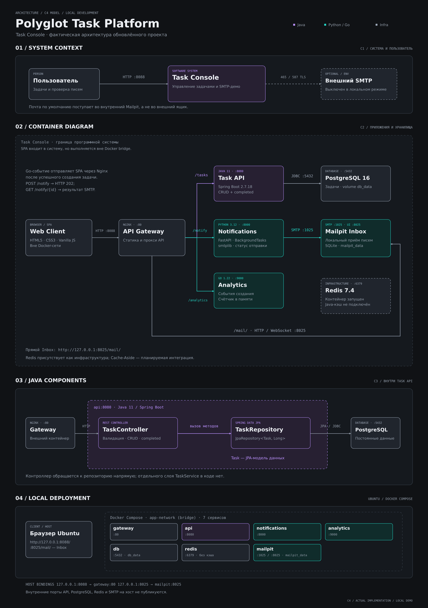

# Task Service — система управления задачами

Учебный микросервисный проект на Java, Python и Go. Пользователь создаёт задачи,
выбирает приоритет, отмечает выполнение и отправляет почтовые уведомления.
Система демонстрирует REST API, взаимодействие сервисов, постоянное хранение
данных и запуск окружения через Docker Compose.

## Возможности

- Создание и просмотр задач с описанием и приоритетом.
- Поиск, фильтрация, отметка выполнения и удаление в веб-интерфейсе.
- Изменение названия, описания и приоритета через REST API.
- Сохранение задач и статусов в PostgreSQL.
- SMTP-отправка уведомлений и просмотр писем в Mailpit.
- Счётчик событий создания задач и индикаторы доступности сервисов.

## Архитектура C4



[Редактируемая SVG-схема](docs/architecture.svg) ·
[Исходная авторская схема](architecture-original.png)

| Уровень | Что показывает |
| --- | --- |
| Context | Пользователь, Task Service и необязательный внешний SMTP-провайдер |
| Container | SPA, Nginx, Java API, Python Notifications, Go Analytics и хранилища |
| Component | TaskController → TaskRepository и JPA-модель Task внутри Java API |
| Deployment | Семь Compose-сервисов, Docker-сеть, тома и опубликованные порты |

SPA выполняется в браузере. Nginx раздаёт её файлы и проксирует HTTP-запросы к API.
Java работает с PostgreSQL, Python передаёт письма Mailpit по SMTP. После успешного
создания задачи SPA отдельно отправляет событие в Go через Nginx.

Внешний порт Gateway — **8088**, внутренний порт Nginx — **80**.
Порты базы и прикладных API на хост не публикуются.

## Сервисы и структура репозитория

| Compose-сервис | Каталог / образ | Технология и ответственность |
| --- | --- | --- |
| api | [api-service/](api-service/) | Java 11, Spring Boot 2.7, Spring Data JPA: CRUD задач |
| notifications | [notification-service/](notification-service/) | Python 3.12, FastAPI, smtplib: фоновая SMTP-отправка |
| analytics | [analytics-service/](analytics-service/) | Go 1.22, net/http: счётчик событий |
| gateway | [gateway/](gateway/) | Nginx: статические файлы и маршрутизация |
| db | postgres:16 | PostgreSQL: постоянное хранение задач |
| mailpit | axllent/mailpit:v1.32.0 | Приём SMTP и почтовый веб-интерфейс |
| redis | redis:7.4-alpine | Инфраструктура для будущего кеширования |

У каждого собственного серверного сервиса есть Dockerfile. PostgreSQL, Mailpit
и Redis используют готовые образы. Файлы SPA находятся в [frontend/](frontend/):
HTML5, CSS3 и Vanilla JavaScript. Интерфейс обслуживает контейнер `gateway`.

Дополнительные каталоги: [docs/](docs/) — архитектура и доказательства проверки,
[scripts/](scripts/) — воспроизводимая проверка запуска и API.

## Запуск с нуля

Нужны Git, Docker Engine и Docker Compose v2 с поддержкой `--wait`.
Сборка требует доступа к Docker Registry, Maven Central и PyPI.
Java, Maven, Python и Go для запуска самих контейнеров на хосте не требуются.

Если проект ещё не скачан:

```bash
git clone https://github.com/danielyarmukhomedov/task-service.git
cd task-service
```

Из корня проекта выполните:

```bash
sudo docker compose config --quiet
sudo docker compose up -d --build --wait --wait-timeout 600
sudo docker compose ps -a
```

Первый запуск занимает несколько минут. Java собирается внутри Docker;
при сборке выполняются пять интеграционных тестов с H2.

Откройте браузер на машине, где запущен Docker:

| Интерфейс | Адрес |
| --- | --- |
| Task Console | http://127.0.0.1:8088/ |
| Mailpit через Gateway | http://127.0.0.1:8088/mail/ |
| Mailpit напрямую | http://127.0.0.1:8025/mail/ |

Используется HTTP. В виртуальной машине открывайте эти адреса внутри Ubuntu.

Повторный запуск и остановка:

```bash
sudo docker compose up -d --wait --wait-timeout 600
sudo docker compose stop
```

Логи:

```bash
sudo docker compose logs --tail=100
```

Не удаляйте тома флагом `docker compose down -v`, если требуется сохранить задачи
и письма. Подробные инструкции для Ubuntu: [TASK_SERVICE_GUIDE_RU.md](TASK_SERVICE_GUIDE_RU.md).

## API и проверка через curl / Postman

| Метод | Путь | Результат |
| --- | --- | --- |
| GET | /tasks | Список задач, 200 |
| POST | /tasks | Создание, 201 |
| PUT | /tasks/{id} | Изменение названия, описания и приоритета, 200 |
| PATCH | /tasks/{id}/completion | Изменение статуса, 200 |
| DELETE | /tasks/{id} | Удаление, 204 |
| POST | /notify | Постановка уведомления на отправку, 202 |
| GET | /notify/{notification_id} | Статус отправки, 200 |
| GET | /analytics | Счётчик событий, 200 |
| POST | /analytics/increment | Увеличение счётчика, 200 |

Приоритеты: `High`, `Medium`, `Low`. Некорректные данные задачи возвращают 400,
неизвестный ID — 404. Ошибки валидации уведомления возвращают 422.

Команды выполняются последовательно в одном Bash-терминале. Нужен curl.

### Получить задачи

```bash
curl -i http://127.0.0.1:8088/tasks
```

Ответ: HTTP 200 и JSON-массив. Nginx передаёт запрос Java API,
который читает записи из PostgreSQL.

### Создать задачу и сохранить её ID

```bash
TASK_RESPONSE=$(curl -fsS -X POST http://127.0.0.1:8088/tasks \
  -H 'Content-Type: application/json' \
  -d '{"title":"Подготовить демонстрацию","description":"Проверить задачи и SMTP","priority":"High"}')
printf '%s\n' "$TASK_RESPONSE"
TASK_ID=$(printf '%s\n' "$TASK_RESPONSE" | sed -n 's/.*"id":[[:space:]]*\([0-9][0-9]*\).*/\1/p')
```

Сервер возвращает HTTP 201 и созданную задачу с ID из базы и `completed: false`.

### Изменить описание и приоритет

```bash
curl -i -X PUT "http://127.0.0.1:8088/tasks/$TASK_ID" \
  -H 'Content-Type: application/json' \
  -d '{"title":"Подготовить демонстрацию","description":"Проверить сохранение изменений","priority":"Low"}'
```

Ответ: HTTP 200, изменённая задача. Результат сохраняется в PostgreSQL.

### Завершить задачу и повторно получить список

```bash
curl -i -X PATCH "http://127.0.0.1:8088/tasks/$TASK_ID/completion" \
  -H 'Content-Type: application/json' \
  -d '{"completed":true}'
curl -i http://127.0.0.1:8088/tasks
```

Оба запроса возвращают 200. У задачи сохраняется `completed: true`.

### Удалить задачу

```bash
curl -i -X DELETE "http://127.0.0.1:8088/tasks/$TASK_ID"
```

Ответ: HTTP 204 без тела. Задача удалена из базы.

### Отправить письмо

```bash
curl -i -X POST http://127.0.0.1:8088/notify \
  -H 'Content-Type: application/json' \
  -d '{"email":"professor@example.com","subject":"Демонстрация Task Service","message":"Письмо передано по SMTP в локальный Mailpit."}'
```

Ответ: HTTP 202 с `notification_id`. Это принятие задания, а не подтверждение
отправки. Статус проверяется через GET `/notify/{notification_id}`; веб-интерфейс
делает это автоматически. `sent` означает подтверждение приёма SMTP-сервером.
Письмо можно открыть в Mailpit и показать получателя, тему и содержимое.

### Получить статистику

```bash
curl -i http://127.0.0.1:8088/analytics
```

Ответ: HTTP 200 с числовым полем `total_tasks`.
Для Postman используйте те же методы, URL и JSON через `Body → raw → JSON`.

## Автоматическая проверка и доказательства

[Скриншоты и результаты](docs/evidence/README.md) включают фактический запуск
в Ubuntu, интерфейс задач и полученное письмо. Инструкции и реальные результаты
проверки размещены отдельно, чтобы их можно было воспроизвести.

Для полной проверки нужны Bash, Python 3 и Docker Compose. Из корня проекта:

```bash
sudo bash scripts/check.sh --check-persistence
```

Команда собирает и запускает стек, проверяет API, SMTP и счётчик Go. Затем
пересоздаёт контейнеры PostgreSQL и Mailpit **с сохранением томов**, перезапускает
Java API и проверяет сохранность тестовой задачи и письма. Во время этого шага
сервисы кратковременно недоступны. Скрипт удаляет только созданную им задачу;
тестовое письмо остаётся в Inbox.

Реальный вывод записывается в `docs/evidence/runtime/`: `compose-up.txt`,
`compose-ps.txt`, `api-check.txt` и `compose-logs.txt`. Этот рабочий каталог
исключён из Git; выбранные результаты можно приложить к сдаче после просмотра.

Запуск с `--check-persistence` выполняется с PostgreSQL 16 из Compose.
Без этого флага можно проверить уже работающее API без пересоздания контейнеров:

```bash
python3 scripts/verify.py
```

## Минимальный сценарий демонстрации

1. Показать `docker compose ps -a` и открыть Task Console.
2. Создать задачу с описанием и высоким приоритетом.
3. Найти её поиском и фильтром, отметить выполненной.
4. Обновить страницу и показать сохранённый статус.
5. Отправить уведомление и открыть полученное письмо в Mailpit.
6. Удалить тестовую задачу.
7. Показать схему C4 и объяснить роли сервисов.

## Хранение данных и границы реализации

- PostgreSQL хранит задачи и статусы в `db_data`, Mailpit — письма в `mailpit_data`.
- Go хранит события в памяти. Счётчик сбрасывается при перезапуске Go,
  не уменьшается при удалении задач и не равен числу записей PostgreSQL.
- Прямой POST /tasks не вызывает Go: событие отдельно отправляет SPA.
- Python использует BackgroundTasks; задания и статусы не являются долговечной очередью.
- Mailpit принимает настоящие SMTP-сообщения локально и не доставляет их
  автоматически во внешние почтовые ящики.
- Для внешнего SMTP поддерживаются ENV-настройки `SMTP_HOST`, `SMTP_PORT`,
  `SMTP_USER`, `SMTP_PASSWORD`, `SMTP_FROM`, `SMTP_SSL`, `SMTP_STARTTLS`.
- Redis-кеш, пользователи, проекты, теги и авторизация пока не реализованы.

Окружение предназначено для локального показа: привязки портов ограничены
127.0.0.1. Пароль PostgreSQL по умолчанию демонстрационный; `.env` исключён из Git.
Изменение переменной пароля не меняет пароль в уже созданном томе базы.

## Соответствие критериям задания

| Критерий | Где показан |
| --- | --- |
| Идея и сценарий | Описание проекта и сценарий демонстрации выше |
| Минимум три сервиса с API | api-service/, notification-service/, analytics-service/ |
| Взаимодействие | HTTP через Nginx, SMTP между Notifications и Mailpit |
| PostgreSQL и постоянные данные | docker-compose.yml, db_data, проверка --check-persistence |
| Dockerfile для собственных сервисов | В каждом из четырёх серверных каталогов |
| Compose: сервисы, сеть, ENV и volumes | docker-compose.yml |
| C4: Context, Container, Component | docs/architecture.svg и docs/architecture.png |
| README, команды и технологии | Этот файл |
| Проверка запуска и API | docs/evidence/ и scripts/ |

Согласование индивидуальной темы, отсутствие повторов в группе и срок сдачи
подтверждаются отдельно с преподавателем.
