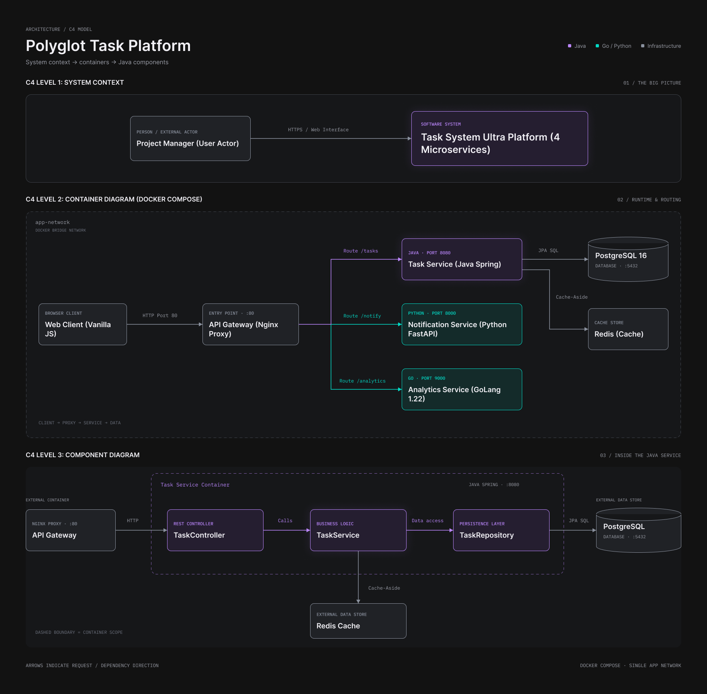

# Polyglot Task Management System (Ultra Edition)

[English Version](#english-version) | [Русская версия](#русская-версия)

---

## Русская версия

Распределенная высоконагруженная микросервисная платформа для управления задачами. Проект демонстрирует паттерны Cloud-Native архитектуры, принципы DevSecOps, полиглот-программирование и интеграцию интерактивных веб-интерфейсов в изолированные контейнерные сети.

### 🏗 Архитектура системы (C4 Model)



Система построена на базе микросервисной архитектуры и включает в себя 4 независимых функциональных компонента, объединенных во внутреннюю изолированную сеть `app-network`:

1. **SPA Frontend (HTML5 / Vanilla JS)** — Интерактивная панель управления в стиле Dark UI, позволяющая полностью контролировать систему (создавать задачи, вызывать алерты, просматривать списки и метрики) в реальном времени прямо из браузера.
2. **API Gateway (Nginx)** — Единственная внешняя точка входа прикладного уровня L7 (Port 80). Отвечает за безопасную раздачу статических файлов фронтенда и проксирование API по контекстным путям, скрывая внутреннюю сеть контейнеров.
3. **Task Service (Java 11 / Spring Boot)** — Ядро бизнес-логики. Реализует CRUD-операции над задачами, интеграцию с реляционной СУБД PostgreSQL 16 и паттерн оптимизации чтения *Cache-Aside* через Redis.
4. **Notification Service (Python 3.9 / FastAPI)** — Легковесный асинхронный сервис уведомлений (имитация отправки Email) с валидацией входящих JSON-структур при помощи Pydantic и логированием в поток stdout.
5. **Analytics Service (GoLang 1.22)** — Высокопроизводительный микросервис на чистом Go без внешних зависимостей, обеспечивающий потоковый сбор и обработку системных метрик в оперативной памяти (In-Memory).

### 🔒 Безопасность и Изоляция (DevSecOps)
В соответствии со стандартами безопасности, порты бэкенд-сервисов Java (8080), Python (8000) и Go (9000), а также баз данных PostgreSQL (5432) и Redis (6379) **полностью закрыты наружу**. Единственным публичным шлюзом является Nginx на порту 80. Все межсервисные коммуникации изолированы внутри приватной мостовой подсети Docker.

### 📦 Быстрое развертывание

```bash
cd ~/task-service
mvn clean package
docker compose up -d --build
```
После успешного запуска откройте браузер Firefox внутри ВМ по адресу: `http://localhost`

### ✅ Верификация API (Сырые JSON запросы)

**1. Получить JSON-список задач (Java + Redis):**
```bash
curl -i http://localhost/tasks
```
**2. Отправить JSON-пакет уведомления (Python FastAPI):**
```bash
curl -i -X POST -H "Content-Type: application/json" -d '{"email":"test@univ.edu", "message":"Hello JSON"}' http://localhost/notify
```
**3. Проверить метрики счетчика (GoLang):**
```bash
curl -i http://localhost/analytics
```

---

## English Version

A distributed, high-load microservice task management platform. This project demonstrates Cloud-Native architecture patterns, DevSecOps principles, polyglot programming, and the integration of interactive web interfaces into isolated container networks.

### 🏗 System Architecture (C4 Model)

The system is built on a microservice architecture and includes 4 independent functional components combined into an internal isolated network named `app-network`:

1. **SPA Frontend (HTML5 / Vanilla JS)** — An interactive control panel in Dark UI style, allowing full system control (creating tasks, triggering alerts, viewing lists and metrics) in real-time directly from the browser.
2. **API Gateway (Nginx)** — The single external entry point at the L7 application layer (Port 80). It handles the secure delivery of frontend static files and transparent API proxying via contextual paths, completely hiding the internal container topology.
3. **Task Service (Java 11 / Spring Boot)** — The core of business logic. Implements CRUD operations on tasks, integration with the relational PostgreSQL 16 database, and the *Cache-Aside* read optimization pattern via Redis.
4. **Notification Service (Python 3.9 / FastAPI)** — A lightweight asynchronous notification service (Email simulation) with incoming JSON structure validation via Pydantic and logging to the stdout stream.
5. **Analytics Service (GoLang 1.22)** — A high-performance microservice written in pure Go without external dependencies, providing streaming metrics aggregation and processing in-memory.

### 🔒 Security and Isolation (DevSecOps)
In accordance with security standards, the ports of the backend services Java (8080), Python (8000), and Go (9000), as well as the databases PostgreSQL (5432) and Redis (6379), are **completely closed to the outside world**. The only public gateway is Nginx on port 80. All inter-service communications are strictly isolated within a private Docker bridge subnet.

### 📦 Quick Deployment

```bash
cd ~/task-service
mvn clean package
docker compose up -d --build
```
After a successful startup, open the Firefox browser inside the VM at: `http://localhost`

### ✅ API Verification (Raw JSON Requests)

**1. Get JSON task list (Java + Redis):**
```bash
curl -i http://localhost/tasks
```
**2. Send JSON notification packet (Python FastAPI):**
```bash
curl -i -X POST -H "Content-Type: application/json" -d '{"email":"test@univ.edu", "message":"Hello JSON"}' http://localhost/notify
```
**3. Check metrics counter (GoLang):**
```bash
curl -i http://localhost/analytics
