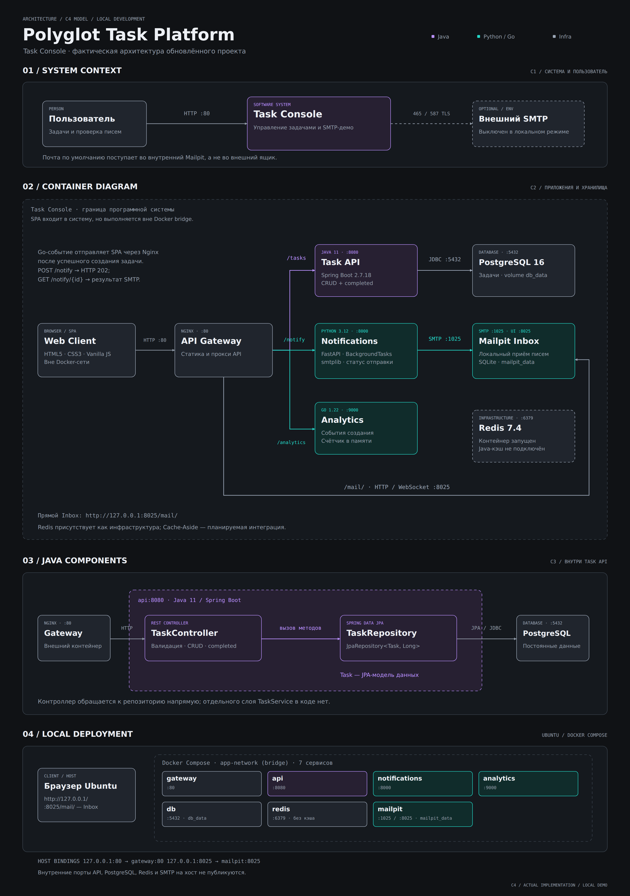

# Task Service — полиглотная система управления задачами

Учебный микросервисный проект для управления задачами, отправки уведомлений и сбора статистики.

Система объединяет сервисы на Java, Python и Go. Веб-интерфейс и API доступны через Nginx. Развёртывание выполняется с помощью Docker Compose.

## 1. Возможности системы

- Создание, просмотр, редактирование и удаление задач.
- Название, описание и приоритет задачи.
- Отметка задачи как выполненной.
- Поиск и фильтрация задач в интерфейсе.
- Сохранение задач и статусов в PostgreSQL.
- Отправка уведомлений по SMTP.
- Просмотр полученных писем через Mailpit.
- Отображение статистики и состояния сервисов.

## 2. Архитектура системы

### Схема C4



[Редактируемая SVG-схема](architecture.svg) · [Исходная авторская схема](architecture-original.png)

Схема включает следующие представления:

- **C1 — System Context:** пользователь и система управления задачами.
- **C2 — Containers:** приложения, базы данных и взаимодействие между ними.
- **C3 — Components:** Java-компоненты TaskController, TaskRepository и модель Task.
- **Deployment:** размещение сервисов в Docker Compose.

В текущем окружении Gateway опубликован на порту **8088**, внутренний порт Nginx — **80**. На изображениях, подготовленных до изменения конфигурации, внешний порт может быть указан как 80.

### Взаимодействие компонентов

1. Пользователь открывает SPA в браузере.
2. Nginx раздаёт файлы интерфейса и направляет API-запросы соответствующим сервисам.
3. Java API обрабатывает задачи и сохраняет их в PostgreSQL.
4. Python-сервис отправляет уведомления через SMTP.
5. Mailpit принимает письма и отображает их в веб-интерфейсе.
6. После создания задачи интерфейс отправляет событие в Go-сервис аналитики.

Сервисы взаимодействуют через Docker-сеть `app-network`.

## 3. Сервисы и технологии

| Сервис | Технология | Назначение |
| --- | --- | --- |
| gateway | Nginx | Раздача SPA и проксирование запросов |
| api | Java 11, Spring Boot, Spring Data JPA | REST API для управления задачами |
| db | PostgreSQL 16 | Постоянное хранение задач |
| notifications | Python 3.12, FastAPI, smtplib | Фоновая отправка SMTP-уведомлений |
| analytics | Go 1.22, net/http | Счётчик событий создания задач |
| mailpit | Mailpit | Приём и просмотр тестовых писем |
| redis | Redis | Инфраструктура для будущего кеширования |

Frontend реализован на **HTML5, CSS3 и Vanilla JavaScript**.

Redis присутствует в окружении, но кеширование Java API через Cache-Aside пока не реализовано.

## 4. Запуск проекта

### Требования

- Ubuntu или другая система с Docker.
- Docker Engine.
- Docker Compose v2.
- Доступ к интернету при первой сборке.

Java, Maven, Python и Go для сборки проекта на хосте устанавливать не требуется.

### Конфигурация портов

Для адресов из этого README у сервиса `gateway` в `docker-compose.yml` должна использоваться привязка:

```yaml
ports:
  - "127.0.0.1:8088:80"
```

У сервиса `mailpit`:

```yaml
ports:
  - "127.0.0.1:8025:8025"
```

### Сборка и запуск

Откройте терминал и выполните из каталога проекта:

```bash
cd ~/task-service
sudo docker compose config --quiet
sudo docker compose up -d --build --wait --wait-timeout 600
sudo docker compose ps -a
```

Первый запуск может занять несколько минут. После запуска сервисы должны находиться в рабочем состоянии, а настроенные проверки здоровья — показывать `healthy`.

### Адреса приложения

Открывайте адреса в браузере Ubuntu, где запущены контейнеры.

| Интерфейс | Адрес |
| --- | --- |
| Task Console | http://127.0.0.1:8088/ |
| Mailpit через Nginx | http://127.0.0.1:8088/mail/ |
| Mailpit напрямую | http://127.0.0.1:8025/mail/ |

Используется протокол **HTTP**.

### Повторный запуск

Если образы уже собраны:

```bash
cd ~/task-service
sudo docker compose up -d --wait --wait-timeout 600
```

### Остановка

```bash
sudo docker compose stop
```

### Просмотр логов

```bash
sudo docker compose logs --tail=100
```

## 5. Основные API-маршруты

| Метод | Маршрут | Назначение |
| --- | --- | --- |
| GET | /tasks | Получить список задач |
| POST | /tasks | Создать задачу |
| PUT | /tasks/{id} | Изменить название, описание и приоритет |
| PATCH | /tasks/{id}/completion | Изменить статус выполнения |
| DELETE | /tasks/{id} | Удалить задачу |
| POST | /notify | Поставить уведомление на отправку |
| GET | /notify/{notification_id} | Получить статус отправки |
| GET | /analytics | Получить счётчик событий |
| POST | /analytics/increment | Увеличить счётчик событий |

Допустимые значения приоритета: `High`, `Medium`, `Low`.

## 6. Проверка через curl / Postman

Команды ниже выполняются последовательно в одном терминале.

### Получение списка задач

**Запрос:**

```bash
curl -i http://127.0.0.1:8088/tasks
```

**Ожидаемый ответ:** HTTP `200`, JSON-массив задач. Если задач нет, возвращается `[]`.

**Работа системы:** Nginx передаёт запрос Java API, приложение получает записи из PostgreSQL и возвращает результат клиенту.

### Создание задачи

**Запрос:**

```bash
TASK_RESPONSE=$(curl -fsS -X POST http://127.0.0.1:8088/tasks \
  -H 'Content-Type: application/json' \
  -d '{"title":"Подготовить демонстрацию","description":"Проверить задачи и SMTP-уведомления","priority":"High"}')

printf '%s\n' "$TASK_RESPONSE"

TASK_ID=$(printf '%s\n' "$TASK_RESPONSE" | sed -n 's/.*"id":[[:space:]]*\([0-9][0-9]*\).*/\1/p')
```

**Ожидаемый ответ:** HTTP `201`, JSON созданной задачи с присвоенным `id` и полем `"completed":false`.

Переменная `TASK_ID` сохраняет идентификатор для следующих проверок.

**Работа системы:** Java API проверяет поля и сохраняет новую задачу в PostgreSQL.

### Завершение задачи

**Запрос:**

```bash
curl -i -X PATCH "http://127.0.0.1:8088/tasks/$TASK_ID/completion" \
  -H 'Content-Type: application/json' \
  -d '{"completed":true}'
```

**Ожидаемый ответ:** HTTP `200`, JSON задачи с полем `"completed":true`.

**Работа системы:** статус обновляется в PostgreSQL. После обновления страницы задача остаётся завершённой.

### Удаление задачи

**Запрос:**

```bash
curl -i -X DELETE "http://127.0.0.1:8088/tasks/$TASK_ID"
```

**Ожидаемый ответ:** HTTP `204`, без тела ответа.

**Работа системы:** задача удаляется из PostgreSQL и больше не возвращается в списке задач.

### Отправка уведомления

**Запрос:**

```bash
curl -i -X POST http://127.0.0.1:8088/notify \
  -H 'Content-Type: application/json' \
  -d '{"email":"professor@example.com","subject":"Демонстрация Task Service","message":"Тестовое письмо отправлено через Python-сервис и принято Mailpit."}'
```

**Ожидаемый ответ:** HTTP `202`, идентификатор уведомления и начальный статус.

**Работа системы:** FastAPI принимает запрос, запускает фоновую отправку через smtplib и передаёт письмо SMTP-серверу Mailpit.

Для проверки результата откройте:

http://127.0.0.1:8025/mail/

В Inbox должны отображаться получатель, тема и содержимое письма.

### Получение аналитики

**Запрос:**

```bash
curl -i http://127.0.0.1:8088/analytics
```

**Ожидаемый ответ:** HTTP `200`, JSON с числовым полем `total_tasks`.

**Работа системы:** Go-сервис возвращает текущее значение счётчика из памяти.

Этот счётчик увеличивается после событий, отправленных интерфейсом. Прямой запрос `POST /tasks` через curl сам по себе его не увеличивает.

### Проверка в Postman

Для выполнения тех же проверок в Postman:

1. Выберите HTTP-метод и укажите URL из примера.
2. Для POST и PATCH откройте `Body → raw → JSON`.
3. Вставьте JSON из соответствующей команды curl.
4. Нажмите `Send`.
5. Проверьте HTTP-статус, тело ответа и изменение данных в интерфейсе.

## 7. Минимальный сценарий использования

1. Открыть Task Console.
2. Создать задачу с названием, описанием и высоким приоритетом.
3. Найти её через поиск или фильтр.
4. Отметить задачу выполненной.
5. Обновить страницу и убедиться, что статус сохранился.
6. Отправить уведомление.
7. Открыть Mailpit и показать полученное письмо.
8. Удалить тестовую задачу.

Сценарий демонстрирует работу интерфейса, маршрутизацию через Nginx, сохранение данных в PostgreSQL и передачу уведомлений по SMTP.

## 8. Хранение данных и особенности реализации

- Задачи и статусы выполнения хранятся в PostgreSQL в томе `db_data`.
- Письма Mailpit хранятся в томе `mailpit_data`.
- Go-счётчик хранится в памяти и сбрасывается при перезапуске сервиса.
- Удаление задач не уменьшает Go-счётчик.
- Фоновые задания и статусы уведомлений Python не восстанавливаются после перезапуска процесса.
- Количество задач в базе и количество событий Go могут различаться.

Для сохранения данных не удаляйте тома командой `docker compose down -v`.

## 9. SMTP-уведомления

По умолчанию используется Mailpit:

- SMTP-хост: `mailpit`.
- SMTP-порт: `1025`.
- Авторизация не требуется.
- TLS в локальном режиме не используется.

Письма действительно передаются по SMTP и сохраняются в Mailpit. Во внешние почтовые ящики они автоматически не отправляются.

Для внешнего SMTP предусмотрены переменные `SMTP_HOST`, `SMTP_PORT`, `SMTP_USER`, `SMTP_PASSWORD`, `SMTP_FROM`, `SMTP_SSL` и `SMTP_STARTTLS`.

Поддерживаются SMTP over TLS на порту 465 и STARTTLS на порту 587.

## 10. Границы учебной версии

Проект предназначен для локальной демонстрации микросервисной архитектуры.

Аутентификация, разграничение доступа, долговечная очередь уведомлений и Redis-кеширование пока не реализованы. Перед публичным размещением необходимы TLS, управление секретами, резервное копирование и дополнительная настройка безопасности.
