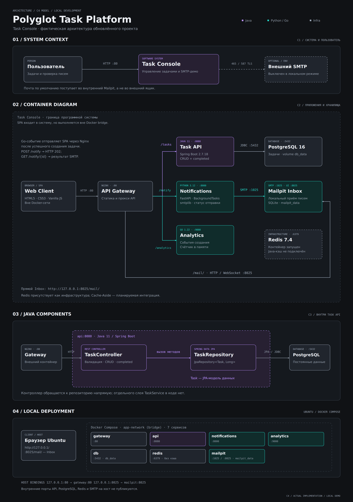

# Task Service: анализ, готовый код и инструкция на русском

Репозиторий: https://github.com/danielyarmukhomedov/task-service
Проверенная исходная версия main: b6ee0f05663a61d3b923d09b8a67ee4096079879.
Дата подготовки: 5 ноября 2026 года.

Комплект содержит полный код четырёх запрошенных файлов и необходимые сопутствующие изменения Java и Docker. Всё работает по умолчанию с Mailpit: настраивать почтовые аккаунты и пароли не требуется.

Mailpit принимает настоящие SMTP-письма и сохраняет их в локальном почтовом ящике. Он не доставляет их автоматически в Gmail, Яндекс и другие внешние ящики. Для демонстрации преподавателю открывай http://localhost:8025/mail/ или http://localhost/mail/.

## 1. Что обнаружено в исходном репозитории

| Наблюдение | Последствие | Изменение в комплекте |
| --- | --- | --- |
| Python только логирует email и возвращает success | Письмо никуда не передаётся | SMTP, BackgroundTasks, HTTP 202 и отдельный статус результата |
| Нет Mailpit и маршрута /mail | Нельзя показать полученное письмо | SMTP 1025 внутри сети, Web UI на 8025 и прокси /mail/ |
| В index.html два HTML-документа и два скрипта | Повторная инициализация и конфликтующие ID | Один документ и один контролируемый цикл обновления |
| Названия задач вставляются в innerHTML | Возможен сохранённый XSS | Пользовательские данные выводятся через textContent |
| У Task нет completed | Завершение нельзя сохранить на сервере | Boolean-поле в PostgreSQL и PATCH /tasks/{id}/completion |
| Go получает инкремент только из браузера | Счётчик расходится с количеством задач и сбрасывается при перезапуске | Раздельные показатели: задачи из API и события Go |
| В pom.xml нет Redis starter, в Java нет кода кэширования | Заявленный Cache-Aside отсутствует | Redis оставлен, README исправлен; внедрение кэша — отдельная следующая задача |
| Dockerfile копирует готовый JAR из target | На чистом clone сборка Docker не самодостаточна | Maven build stage и запуск тестов внутри сборки |
| depends_on не проверяет готовность | API может стартовать раньше PostgreSQL | Healthchecks и service_healthy |

Исходники для проверки выводов:

- https://github.com/danielyarmukhomedov/task-service/blob/b6ee0f05663a61d3b923d09b8a67ee4096079879/notification-service/main.py
- https://github.com/danielyarmukhomedov/task-service/blob/b6ee0f05663a61d3b923d09b8a67ee4096079879/frontend/index.html
- https://github.com/danielyarmukhomedov/task-service/blob/b6ee0f05663a61d3b923d09b8a67ee4096079879/src/main/java/com/example/taskservice/Task.java
- https://github.com/danielyarmukhomedov/task-service/blob/b6ee0f05663a61d3b923d09b8a67ee4096079879/pom.xml
- https://github.com/danielyarmukhomedov/task-service/blob/b6ee0f05663a61d3b923d09b8a67ee4096079879/analytics-service/main.go

## 2. Что получится

- Тёмная адаптивная консоль с Bento Grid, поиском, фильтрами приоритетов и статусов.
- Создание, удаление с подтверждением, завершение и возврат задачи в работу.
- Сохранение задач и завершения в PostgreSQL; прежний db_data сохранён.
- Обновление данных каждые 5 секунд и после изменений.
- Реальные индикаторы доступности Java/DB, Python/SMTP, Go, Nginx и Mailpit.
- Настоящая отправка кириллицы через smtplib.SMTP в Mailpit.
- Поддержка внешних SMTP_SSL, STARTTLS и авторизации с проверкой сертификатов.
- Подтверждение SMTP-приёма через GET /notify/{notification_id}; HTTP 202 не выдаётся за доставку.
- Постоянное хранение писем в mailpit_data.
- Порты 80 и 8025 доступны только на 127.0.0.1; SMTP 1025, API и базы наружу не публикуются.

Python-контейнер обновлён до 3.12. Java 11 и Go 1.22 сохранены для совместимости с текущим проектом. Весь frontend остаётся одним HTML-файлом без CDN, фреймворков и внешних шрифтов.

### Актуальная C4-схема



[Редактируемый SVG](architecture.svg) · [Исходная авторская схема](architecture-original.png)

Схема обновлена по фактическому коду комплекта. На плакате четыре панели: C1 System Context, C2 Containers, C3 Java Components и Local Deployment. Добавлен Mailpit; используется локальный HTTP; браузер вынесен из Docker bridge; Redis показан без активного кэша; TaskController обращается непосредственно к TaskRepository.

Файл architecture.png — экспорт проверенного SVG, 3000 × 4260 px. Редактируемый architecture.svg имеет viewBox 2000 × 2840. Исходный PNG из репозитория сохранён побайтно как architecture-original.png.

### Параметры для актуализации C4

Ниже перечислены параметры, использованные для обновлённой схемы. Они проверены по исходникам и docker-compose.yml комплекта и описывают текущее локальное демо.

| Параметр | Значение для генерации |
| --- | --- |
| Название системы | Polyglot Task Platform / Task Console |
| Уровни | Сохранить исходные три уровня: C1 System Context, C2 Containers, C3 Components Java API |
| Развёртывание | Отдельная Deployment-схема или отдельная панель: Ubuntu, Docker Compose, bridge app-network |
| Актор | Пользователь / преподаватель; просмотр, CRUD, завершение задач и проверка писем |
| Среда доступа | HTTP в локальном демо; Nginx на 127.0.0.1:80; Mailpit Web UI на 127.0.0.1:8025/mail/ |
| SPA | HTML5, CSS3, Vanilla JS; загружается с Nginx, выполняется в браузере вне Docker bridge |
| Gateway | gateway:80, Nginx; раздача SPA и маршруты /tasks, /notify, /analytics, /mail/ |
| Task API | api:8080, Java 11, Spring Boot 2.7.18, Spring Data JPA; CRUD и completed |
| Notifications | notifications:8000, Python 3.12, FastAPI, BackgroundTasks, стандартный smtplib |
| Analytics | analytics:9000, Go 1.22, счётчик событий в памяти процесса |
| PostgreSQL | db:5432, PostgreSQL 16; база app; постоянный Docker volume db_data |
| Redis | redis:6379, Redis 7.4; контейнер запущен, Java-кэш не подключён |
| Mailpit | mailpit:1025 SMTP; mailpit:8025 HTTP/WebSocket; MP_WEBROOT=mail; SQLite /data/mailpit.db в volume mailpit_data |
| Внешняя почта | Необязательный внешний SMTP-провайдер, включается ENV; 465 implicit TLS или 587 STARTTLS |
| Хранение статусов писем | Память одного процесса Python; без долговечной очереди и без Redis-хранилища статусов |
| Стиль | Сохранить тёмный графитовый фон исходника; фиолетовый Java, бирюзовый Python/Go, серый инфраструктура; ровные линии и читаемые подписи |
| Язык | Русские пояснения; имена классов, сервисов, протоколы и URL оставить как в коде |
| Выходной формат | Редактируемый architecture.svg и PNG-экспорт architecture.png; четыре панели C1, C2, C3 Java API и Local Deployment |

На C2 контейнер означает приложение или хранилище данных, а не обязательно Docker-контейнер. SPA входит в логическую границу системы, но выполняется вне app-network. Привязки к Ubuntu, Docker bridge, host-порты и тома относятся к Deployment-представлению.

Фактические связи:

| Откуда | Куда | Протокол и назначение |
| --- | --- | --- |
| Пользователь / браузер | Nginx | HTTP 80: загрузка SPA и запросы интерфейса |
| Nginx | Java API | HTTP 8080: /tasks, /tasks/{id}, /tasks/{id}/completion |
| Java API | PostgreSQL | PostgreSQL wire protocol через JDBC, порт 5432; доступ через Spring Data JPA |
| Nginx | Python Notifications | HTTP 8000: POST /notify, GET /notify/{notification_id} |
| Python Notifications | Mailpit | SMTP 1025; отправка письма в локальный почтовый ящик |
| Браузер через Nginx | Go Analytics | HTTP 9000: GET /analytics, POST /analytics/increment |
| Nginx | Mailpit UI/API | HTTP и WebSocket на 8025; сохранение префикса /mail/ |
| Браузер | Mailpit напрямую | HTTP host-порт 8025, путь /mail/ |
| Python Notifications | Внешний SMTP | Необязательная ENV-ветвь: 465 TLS или 587 STARTTLS; в локальном режиме не используется |
| Java API | Redis | Только планируемая интеграция; не изображать как работающий Cache-Aside |

Для C3 показывать TaskController → TaskRepository → PostgreSQL. Task — JPA-модель данных рядом с репозиторием. Не добавлять отсутствующие TaskService, CacheService, RedisTemplate, брокер сообщений, OAuth или другие несуществующие компоненты.

Легенда: сплошные стрелки — реализованные связи; пунктирная связь с внешним SMTP — необязательная ENV-ветвь, выключенная по умолчанию. Пунктирная рамка Redis и подпись подчёркивают отсутствие Java-интеграции. Граница C2 — программная система; граница в Deployment — Docker bridge app-network.

Сохранены три уровня исходного плаката и добавлена панель Local Deployment. Публикационные файлы architecture.svg и architecture.png содержат точный текст и проверенные связи. SVG позволяет редактировать каждый узел, подпись и соединение.

Официальная нотация: [C4 Container diagram](https://c4model.com/diagrams/container), [C4 Deployment diagram](https://c4model.com/diagrams/deployment).

### Обновление только документации в Ubuntu

Скачай обновлённый архив task-service-mailpit-console.zip в домашнюю папку Ubuntu. Применить документацию, актуальные PNG/SVG и оригинальную схему можно одной командой:

```bash
unzip -o "$HOME/task-service-mailpit-console.zip" README.md TASK_SERVICE_GUIDE_RU.md architecture.png architecture.svg architecture-original.png -d "$HOME/task-service"
```

Проверка:

```bash
cd ~/task-service
ls -lh README.md TASK_SERVICE_GUIDE_RU.md architecture.png architecture.svg architecture-original.png
git diff -- README.md TASK_SERVICE_GUIDE_RU.md
```

Изменения относятся к документации; пересборка Docker для этого шага не нужна.

## 3. Подготовка репозитория

Команды предназначены для Bash в Linux или WSL2 с Docker Compose v2. Для Windows с Docker Desktop включи интеграцию с используемым дистрибутивом WSL.

Если репозиторий ещё не скачан:

```bash
cd ~
git clone https://github.com/danielyarmukhomedov/task-service.git
cd task-service
```

Если он уже существует:

```bash
cd ~/task-service
```

Проверь локальные изменения и создай ветку:

```bash
git status --short
git diff HEAD > ../task-service-before-mailpit.patch
git switch -c feat/mailpit-console
mkdir -p frontend gateway notification-service src/test/java/com/example/taskservice
```

Если ветка уже создана, вместо её повторного создания используй:

```bash
git switch feat/mailpit-console
```

Файл patch сохраняет изменения отслеживаемых файлов; новые неотслеживаемые файлы в него не входят.

Если в работающей базе уже есть важные задачи, перед обновлением сделай резервную копию:

```bash
mkdir -p ../task-service-backups
docker compose exec -T db pg_dump -U postgres -d app > ../task-service-backups/before-mailpit.sql
```

Архив task-service-mailpit-console.zip содержит обновления с путями относительно корня репозитория. В архив включены актуальные architecture.png и architecture.svg, а оригинальная схема сохранена как architecture-original.png. Расположи эти файлы рядом с README.md и TASK_SERVICE_GUIDE_RU.md. Можно перенести его содержимое в существующий clone. При ручном вводе используй следующие разделы с nano: каждый блок содержит файл целиком.

Важно заменить весь старый index.html, включая вторую копию HTML. В nano можно перейти в начало Alt+\, начать выделение Ctrl+6, перейти в конец Alt+/ и удалить выделенное Ctrl+K. Затем вставь новый код. Для сохранения: Ctrl+O, Enter, Ctrl+X.

Четырёх основных файлов недостаточно для сохранения завершения и новой проверки здоровья Java. Примени все сопутствующие файлы из комплекта.

## 4. Файлы целиком

### 4.1. docker-compose.yml

```bash
nano docker-compose.yml
```

```yaml
services:
  gateway:
    build: ./gateway
    restart: unless-stopped
    ports:
      - "127.0.0.1:80:80"
    volumes:
      - ./frontend:/usr/share/nginx/html:ro
      - ./gateway/nginx.conf:/etc/nginx/nginx.conf:ro
    depends_on:
      api:
        condition: service_healthy
      notifications:
        condition: service_healthy
      analytics:
        condition: service_healthy
    healthcheck:
      test: ["CMD", "wget", "-q", "-O", "/dev/null", "http://127.0.0.1/health/gateway"]
      interval: 10s
      timeout: 3s
      retries: 5
    networks: [app-network]

  api:
    build: .
    restart: unless-stopped
    environment:
      DB_HOST: db
      DB_NAME: app
      DB_USER: postgres
      DB_PASSWORD: ${DB_PASSWORD:-1234}
    depends_on:
      db:
        condition: service_healthy
    healthcheck:
      test: ["CMD", "curl", "-fsS", "http://127.0.0.1:8080/actuator/health"]
      interval: 10s
      timeout: 5s
      retries: 12
      start_period: 40s
    networks: [app-network]

  notifications:
    build: ./notification-service
    restart: unless-stopped
    environment:
      SMTP_HOST: ${SMTP_HOST:-mailpit}
      SMTP_PORT: ${SMTP_PORT:-}
      SMTP_USER: ${SMTP_USER:-}
      SMTP_PASSWORD: ${SMTP_PASSWORD:-}
      SMTP_FROM: ${SMTP_FROM:-}
      SMTP_SSL: ${SMTP_SSL:-}
      SMTP_STARTTLS: ${SMTP_STARTTLS:-}
      SMTP_TIMEOUT: ${SMTP_TIMEOUT:-10}
    depends_on:
      mailpit:
        condition: service_healthy
    healthcheck:
      test: ["CMD", "python", "-c", "import urllib.request; urllib.request.urlopen('http://127.0.0.1:8000/health', timeout=4)"]
      interval: 10s
      timeout: 5s
      retries: 5
    networks: [app-network]

  analytics:
    build: ./analytics-service
    restart: unless-stopped
    healthcheck:
      test: ["CMD", "wget", "-q", "-O", "/dev/null", "http://127.0.0.1:9000/analytics"]
      interval: 10s
      timeout: 3s
      retries: 5
    networks: [app-network]

  mailpit:
    image: axllent/mailpit:v1.32.0
    restart: unless-stopped
    environment:
      MP_DATABASE: /data/mailpit.db
      MP_WEBROOT: mail
      MP_MAX_MESSAGES: "1000"
      MP_DISABLE_VERSION_CHECK: "true"
    volumes:
      - mailpit_data:/data
    ports:
      - "127.0.0.1:8025:8025"
    healthcheck:
      test: ["CMD", "/mailpit", "readyz"]
      interval: 5s
      timeout: 3s
      retries: 10
    networks: [app-network]

  db:
    image: postgres:16
    restart: unless-stopped
    environment:
      POSTGRES_DB: app
      POSTGRES_USER: postgres
      POSTGRES_PASSWORD: ${DB_PASSWORD:-1234}
    volumes:
      - db_data:/var/lib/postgresql/data
    healthcheck:
      test: ["CMD-SHELL", "pg_isready -U $${POSTGRES_USER} -d $${POSTGRES_DB}"]
      interval: 5s
      timeout: 3s
      retries: 12
    networks: [app-network]

  # Java caching is not implemented yet. Container retained for compatibility.
  redis:
    image: redis:7.4-alpine
    restart: unless-stopped
    command: ["redis-server", "--maxmemory", "128mb", "--maxmemory-policy", "allkeys-lru"]
    healthcheck:
      test: ["CMD", "redis-cli", "ping"]
      interval: 10s
      timeout: 3s
      retries: 5
    networks: [app-network]

volumes:
  db_data:
  mailpit_data:

networks:
  app-network:
    driver: bridge
```

### 4.2. notification-service/main.py

```bash
nano notification-service/main.py
```

```python
import logging
import os
import smtplib
import socket
import ssl
import time
from contextlib import contextmanager
from email.message import EmailMessage
from email.utils import formatdate, make_msgid
from threading import Lock
from typing import Dict
from uuid import uuid4

from fastapi import BackgroundTasks, FastAPI, HTTPException, status
from pydantic import BaseModel, EmailStr, Field

logging.basicConfig(level=logging.INFO)
logger = logging.getLogger("notifications")
app = FastAPI(title="Task Console Notifications", docs_url=None, redoc_url=None)


def env_bool(name: str, default: bool) -> bool:
    value = os.getenv(name, "").strip().lower()
    if not value:
        return default
    if value not in {"true", "false", "1", "0", "yes", "no"}:
        raise RuntimeError("Invalid boolean setting: " + name)
    return value in {"true", "1", "yes"}


SMTP_HOST = os.getenv("SMTP_HOST", "mailpit").strip() or "mailpit"
SMTP_USER = os.getenv("SMTP_USER", "").strip()
SMTP_PASSWORD = os.getenv("SMTP_PASSWORD", "")
SMTP_SSL = env_bool("SMTP_SSL", False)
SMTP_PORT = int(os.getenv("SMTP_PORT", "").strip() or
                ("1025" if SMTP_HOST == "mailpit" else "465" if SMTP_SSL else "587"))
SMTP_SSL = env_bool("SMTP_SSL", SMTP_PORT == 465)
SMTP_STARTTLS = env_bool("SMTP_STARTTLS", SMTP_HOST != "mailpit" and not SMTP_SSL)
SMTP_FROM = os.getenv("SMTP_FROM", "").strip() or SMTP_USER or "no-reply@task-service.local"
SMTP_TIMEOUT = float(os.getenv("SMTP_TIMEOUT", "10"))
if SMTP_SSL and SMTP_STARTTLS:
    raise RuntimeError("Choose SMTP_SSL or SMTP_STARTTLS")
if bool(SMTP_USER) != bool(SMTP_PASSWORD):
    raise RuntimeError("SMTP_USER and SMTP_PASSWORD must be set together")
if SMTP_USER and not (SMTP_SSL or SMTP_STARTTLS):
    raise RuntimeError("SMTP authentication requires TLS")
if not 1 <= SMTP_PORT <= 65535 or not 0 < SMTP_TIMEOUT <= 30:
    raise RuntimeError("Invalid SMTP port or timeout")
if "\r" in SMTP_FROM or "\n" in SMTP_FROM or "@" not in SMTP_FROM:
    raise RuntimeError("Invalid SMTP_FROM")

jobs: Dict[str, dict] = {}
jobs_lock = Lock()
MAX_RECORDS, MAX_PENDING, RETENTION_SECONDS = 500, 50, 3600


class Notification(BaseModel):
    email: EmailStr
    message: str = Field(min_length=1, max_length=10000)
    subject: str = Field(default="Уведомление Task Console", min_length=1, max_length=180)


@contextmanager
def smtp_connection():
    if SMTP_SSL:
        client = smtplib.SMTP_SSL(SMTP_HOST, SMTP_PORT, timeout=SMTP_TIMEOUT,
                                  context=ssl.create_default_context())
    else:
        client = smtplib.SMTP(SMTP_HOST, SMTP_PORT, timeout=SMTP_TIMEOUT)
    try:
        client.ehlo()
        if SMTP_STARTTLS:
            client.starttls(context=ssl.create_default_context())
            client.ehlo()
        if SMTP_USER:
            client.login(SMTP_USER, SMTP_PASSWORD)
        yield client
    finally:
        # QUIT failure after successful DATA must not mark accepted mail as failed.
        try:
            client.quit()
        except (OSError, smtplib.SMTPException):
            client.close()


def deliver(notification_id: str, notification: Notification):
    with jobs_lock:
        jobs[notification_id]["status"] = "sending"
    try:
        message = EmailMessage()
        message["From"] = SMTP_FROM
        message["To"] = str(notification.email)
        message["Subject"] = notification.subject
        message["Date"] = formatdate(localtime=False)
        message["Message-ID"] = make_msgid(domain="task-service.local")
        message.set_content(notification.message, charset="utf-8")
        with smtp_connection() as client:
            client.send_message(message, from_addr=SMTP_FROM,
                                to_addrs=[str(notification.email)])
        with jobs_lock:
            jobs[notification_id].update(status="sent", finished_at=time.time())
        logger.info("SMTP accepted notification_id=%s", notification_id)
    except Exception as exc:
        with jobs_lock:
            jobs[notification_id].update(status="failed", finished_at=time.time(),
                error="SMTP-сервер не подтвердил приём. Проверьте настройки и логи.")
        logger.error("SMTP failed notification_id=%s error_type=%s", notification_id,
                     type(exc).__name__)


@app.get("/")
def root():
    return {"service": "notifications", "status": "running"}


@app.get("/health")
def health():
    try:
        with socket.create_connection((SMTP_HOST, SMTP_PORT), timeout=2):
            pass
    except OSError:
        raise HTTPException(status_code=503, detail="SMTP connection unavailable")
    return {"status": "ok", "smtp": "reachable",
            "mode": "mailpit" if SMTP_HOST == "mailpit" else "external"}


@app.post("/notify", status_code=status.HTTP_202_ACCEPTED)
def notify(notification: Notification, background_tasks: BackgroundTasks):
    if not notification.message.strip() or not notification.subject.strip():
        raise HTTPException(status_code=422, detail="Тема и текст не должны быть пустыми")
    if "\r" in notification.subject or "\n" in notification.subject:
        raise HTTPException(status_code=422, detail="Недопустимый заголовок письма")
    notification_id, now = str(uuid4()), time.time()
    with jobs_lock:
        expired = [key for key, job in jobs.items()
                   if job["status"] in {"sent", "failed"}
                   and now - job["finished_at"] > RETENTION_SECONDS]
        for key in expired:
            del jobs[key]
        pending = sum(job["status"] in {"queued", "sending"} for job in jobs.values())
        if pending >= MAX_PENDING:
            raise HTTPException(status_code=429, detail="Очередь отправки заполнена")
        if len(jobs) >= MAX_RECORDS:
            finished = next((key for key, job in jobs.items()
                             if job["status"] in {"sent", "failed"}), None)
            if finished:
                del jobs[finished]
        result = {"notification_id": notification_id, "status": "queued",
                  "sent_to": str(notification.email), "created_at": now}
        jobs[notification_id] = dict(result)
    background_tasks.add_task(deliver, notification_id, notification)
    return result


@app.get("/notify/{notification_id}")
def notification_status(notification_id: str):
    with jobs_lock:
        job = jobs.get(notification_id)
        if not job:
            raise HTTPException(status_code=404, detail="Статус истёк или сервис перезапущен")
        return dict(job)
```

### 4.3. frontend/index.html

```bash
nano frontend/index.html
```

```html
<!doctype html>
<html lang="ru">
<head>
<meta charset="utf-8">
<meta name="viewport" content="width=device-width, initial-scale=1">
<meta name="theme-color" content="#090c10">
<title>Task Console · Рабочее пространство</title>
<style>
:root{color-scheme:dark;--bg:#090c10;--panel:#11161c;--line:#252c34;--text:#edf2f7;--muted:#909ba9;--lime:#c5f277;--red:#ff8a93;--blue:#89baff;--amber:#edc97c}
*{box-sizing:border-box}body{margin:0;background:var(--bg);color:var(--text);font:14px/1.5 system-ui,-apple-system,"Segoe UI",sans-serif}
button,input,select,textarea{font:inherit}button,a,input,select,textarea{-webkit-tap-highlight-color:transparent}
button,a{touch-action:manipulation}button{cursor:pointer}button:disabled{opacity:.45;cursor:wait}
a{color:inherit;text-decoration:none}button:focus-visible,a:focus-visible,input:focus-visible,select:focus-visible,textarea:focus-visible{outline:2px solid var(--lime);outline-offset:4px}
button{border:1px solid var(--line);border-radius:9px;background:#1a222b;color:var(--text);padding:10px 14px;font-weight:600;transition:background .18s}
button:hover:not(:disabled){background:#293340}.primary{background:var(--lime);color:#172014;border-color:var(--lime)}.primary:hover:not(:disabled){background:#d7ff97}
.ghost{background:transparent}.muted{color:var(--muted)}.mono,.eyebrow{font-family:ui-monospace,SFMono-Regular,Consolas,monospace}.eyebrow{color:var(--muted);font-size:10px;letter-spacing:1.8px;text-transform:uppercase}
.sidebar{width:220px;position:fixed;inset:0 auto 0 0;border-right:1px solid var(--line);padding:28px 20px;display:flex;flex-direction:column;background:#0c1015}
.brand{display:flex;align-items:center;gap:10px;font-size:15px;font-weight:750;letter-spacing:-.4px}
.brand-mark{width:32px;height:32px;display:grid;place-items:center;background:var(--lime);color:#172014;border-radius:9px;font-size:21px}
.project{margin:34px 0 28px;padding:12px;border:1px solid var(--line);border-radius:10px;background:#141a21}.project small{display:block;color:var(--muted);font-size:11px}
nav{display:grid;gap:6px}nav a{padding:10px 12px;color:var(--muted);border-radius:8px;display:flex;align-items:center;gap:12px}nav a:hover{color:var(--text);background:#151c24}
nav a.active{background:#202b20;color:var(--lime)}nav a span:first-child{font-size:17px;width:20px;text-align:center}
.side-foot{margin-top:auto;border-top:1px solid var(--line);padding-top:20px;font-size:11px;color:var(--muted)}.avatar{width:29px;height:29px;border-radius:50%;background:#2a3440;display:inline-grid;place-items:center;margin-right:8px;color:#e9eef5}
main{margin-left:220px;padding:0 36px 32px;max-width:1760px}.topbar{height:77px;border-bottom:1px solid var(--line);display:flex;justify-content:space-between;align-items:center;gap:14px}
.breadcrumb{font-size:12px;color:var(--muted)}.breadcrumb strong{color:var(--text);font-weight:500}.env{display:flex;align-items:center;gap:8px;font-size:11px;border:1px solid var(--line);border-radius:6px;padding:5px 9px;color:#c5ced9}
.dot{width:6px;height:6px;border-radius:50%;background:var(--muted);display:inline-block;flex-shrink:0}.env .dot{background:var(--lime)}
.hero{display:flex;justify-content:space-between;gap:20px;align-items:center;padding:32px 0 25px}.hero h1{font-size:clamp(25px,3vw,37px);font-weight:650;line-height:1.2;letter-spacing:-1.4px;margin:8px 0 9px}.hero p{margin:0;color:var(--muted);font-size:13px}
.inbox{display:inline-flex;gap:12px;align-items:center;padding:11px 16px;border:1px solid #3d5032;border-radius:9px;background:#1b2419;color:var(--lime);white-space:nowrap;font-size:12px;font-weight:600}.inbox:hover{background:#273422}
.stats{display:grid;grid-template-columns:repeat(4,minmax(0,1fr));gap:16px}.card{background:var(--panel);border:1px solid var(--line);border-radius:14px}
.stat{padding:18px 20px;position:relative;overflow:hidden}.stat-label{font-size:12px;color:var(--muted);display:flex;justify-content:space-between;gap:10px}.stat-symbol{color:#677380}.stat-number{font-size:35px;letter-spacing:-1.3px;font-weight:600;line-height:1.2;margin:16px 0 9px;font-variant-numeric:tabular-nums}
.stat small{font-size:10px;color:var(--muted)}.stat.accent{background:linear-gradient(115deg,#1e2a20,#141c18);border-color:#3a4d35}.stat.accent .stat-number{color:var(--lime)}
.workspace{display:grid;grid-template-columns:minmax(0,1.8fr) minmax(290px,1fr);gap:20px;margin-top:22px;align-items:stretch}.task-panel{overflow:hidden;min-height:550px;display:flex;flex-direction:column}
.panel-head{padding:21px 22px 18px;border-bottom:1px solid var(--line);display:flex;justify-content:space-between;align-items:center;gap:12px}h2{font-size:15px;font-weight:600;margin:0;letter-spacing:-.3px}
.panel-head p{font-size:11px;color:var(--muted);margin:5px 0 0}.small-btn{font-size:11px;padding:7px 10px;white-space:nowrap}
.filters{padding:16px 22px;border-bottom:1px solid var(--line);display:grid;gap:12px}.filter-row{display:flex;gap:10px}.filter-row input{min-width:0;flex:1}.filter-row select{width:145px}
input,select,textarea{width:100%;border:1px solid #303944;border-radius:8px;background:#0b1016;color:var(--text);padding:10px 11px;font-size:12px;transition:border-color .2s}
input::placeholder,textarea::placeholder{color:#6f7c8d}input:hover,select:hover,textarea:hover{border-color:#536171}textarea{resize:vertical;min-height:76px}
.tabs{display:flex;gap:4px}.tab{border-color:transparent;background:none;font-size:11px;color:var(--muted);padding:6px 10px}.tab[aria-pressed=true]{color:var(--lime);background:#222e20}
.task-list{list-style:none;padding:0 22px;margin:0;flex:1}.task{padding:18px 0;border-bottom:1px solid var(--line);display:flex;align-items:flex-start;gap:12px}.task:last-child{border-bottom:0}
.check{width:24px;height:24px;border-radius:7px;padding:0;flex-shrink:0;font-size:14px;color:var(--lime);margin-top:3px;background:#111820}.task.done .check{background:#27371f;border-color:#4b6636}
.task-body{min-width:0;flex:1}.task-title{font-size:13px;font-weight:550;overflow-wrap:anywhere;margin:7px 0 4px}.task.done .task-title{text-decoration:line-through;color:var(--muted)}
.task-meta{display:flex;gap:9px;align-items:center;font-size:10px;color:var(--muted)}.task-desc{font-size:11px;color:var(--muted);margin:0;white-space:pre-wrap;overflow-wrap:anywhere}
.badge{font-size:9px;padding:2px 7px;border:1px solid #354250;border-radius:5px;color:#b0bfcd}.badge.high{color:var(--red);background:#2c1b22;border-color:#4c2b35}.badge.medium{color:var(--amber);background:#28241a;border-color:#443e29}.badge.low{color:var(--blue);background:#182534;border-color:#2c4058}
.remove{background:none;border:0;padding:4px 6px;font-size:20px;line-height:1;color:#8693a1}.remove:hover:not(:disabled){color:var(--red);background:#302028}
.empty{text-align:center;padding:65px 20px;color:var(--muted);font-size:12px}.empty b{display:block;font-size:27px;margin-bottom:12px;color:#536171;font-weight:400}
.panel-footer{border-top:1px solid var(--line);padding:12px 22px;display:flex;justify-content:space-between;gap:12px;font-size:10px;color:var(--muted)}.live{color:var(--lime)}
.right-column{display:grid;gap:20px;align-content:start}.form-card{padding:21px 22px}.card-heading{display:flex;justify-content:space-between;align-items:center;margin-bottom:18px}.service-tag{font-size:9px;letter-spacing:1px;color:var(--muted);border:1px solid var(--line);padding:3px 6px;border-radius:5px}
form{display:grid;gap:12px}label{display:block;font-size:11px;color:#b4bfcb;margin-bottom:6px}.form-card .primary{width:100%;font-size:12px;margin-top:2px}
.form-caption{font-size:10px;color:var(--muted);margin:12px 0 0}.mail-card{border-color:#354038;background:linear-gradient(145deg,#17201c,#11161c 65%)}
.mail-card .eyebrow{color:var(--lime)}.mail-card h2{margin:8px 0 5px}.mail-card>p{margin:0 0 18px;color:var(--muted);font-size:11px}.mail-status{font-size:11px;color:var(--muted);margin:13px 0 0;overflow-wrap:anywhere}.mail-status[data-state=sent]{color:var(--lime)}.mail-status[data-state=failed]{color:var(--red)}
.mail-links{display:flex;justify-content:space-between;gap:10px;margin-top:14px;font-size:10px;color:#a7ba9b}.mail-links a:hover{text-decoration:underline}
.systems{margin-top:22px;padding:18px 22px;display:grid;grid-template-columns:160px 1fr;align-items:center;gap:22px}.systems h2{font-size:12px}.systems p{margin:4px 0 0;font-size:10px;color:var(--muted)}
.service-list{display:grid;grid-template-columns:repeat(5,minmax(0,1fr));gap:12px}.service-item{border-left:1px solid var(--line);padding-left:16px}.service-item strong{font-size:11px;font-weight:500}.service-state{font-size:9px;color:var(--muted);display:flex;align-items:center;gap:6px;margin-top:6px}.service-item[data-state=up] .dot{background:var(--lime)}.service-item[data-state=down] .dot{background:var(--red)}
.bottom{display:flex;justify-content:space-between;gap:20px;margin-top:18px;font-size:10px;color:#738091}.progress-row{display:flex;align-items:center;gap:9px}.progress-row progress{width:100px;height:4px;accent-color:var(--lime)}
#toast{position:fixed;bottom:24px;right:24px;max-width:min(440px,calc(100vw - 32px));padding:13px 17px;background:#1b2720;border:1px solid #5c7845;border-radius:10px;color:var(--text);font-size:12px;z-index:20;box-shadow:0 15px 45px #0008}#toast[data-error=true]{background:#2c1c23;border-color:#874653}
dialog{color:var(--text);background:var(--panel);border:1px solid var(--line);border-radius:15px;padding:26px;max-width:420px;width:calc(100% - 32px)}dialog::backdrop{background:#000a;backdrop-filter:blur(4px)}dialog p{color:var(--muted);font-size:13px;overflow-wrap:anywhere}.dialog-actions{display:flex;justify-content:flex-end;gap:10px;margin-top:22px}.danger{background:#44262e;color:#ffb7bd;border-color:#6d3743}
[hidden]{display:none!important}
@media(min-width:1600px){main{padding-left:48px;padding-right:48px}.task-panel{min-height:600px}}
@media(max-width:1180px){.sidebar{width:185px;padding:25px 15px}main{margin-left:185px;padding:0 24px 24px}.workspace{grid-template-columns:minmax(0,1.4fr) minmax(280px,1fr)}.systems{grid-template-columns:1fr;gap:16px}.stat{padding:16px}.stat small{font-size:9px}}
@media(max-width:940px){.sidebar{display:none}main{margin-left:0}.workspace{grid-template-columns:minmax(0,1.4fr) minmax(280px,1fr)}.hero h1{font-size:31px}.hero{padding-top:26px}}
@media(max-width:720px){main{padding:0 16px 24px}.topbar{height:62px}.breadcrumb{font-size:10px}.hero{align-items:flex-start;flex-direction:column;gap:18px}.hero h1{font-size:30px}.stats{grid-template-columns:repeat(2,minmax(0,1fr));gap:10px}.stat-number{font-size:31px;margin:12px 0 7px}.workspace{grid-template-columns:1fr;gap:16px}.right-column{grid-template-columns:1fr}.task-panel{min-height:380px}.service-list{grid-template-columns:repeat(3,minmax(0,1fr));row-gap:20px}.systems{padding:18px}.service-item{padding-left:10px}.bottom{flex-direction:column;gap:8px}.filter-row select{width:126px}.panel-head,.filters,.task-list{padding-left:16px;padding-right:16px}.hero p{font-size:12px}}
@media(prefers-reduced-motion:reduce){*{transition:none!important;scroll-behavior:auto!important}}
</style>
</head>
<body>
<aside class="sidebar" aria-label="Навигация">
  <a class="brand" href="/"><span class="brand-mark" aria-hidden="true">⌘</span> task / console</a>
  <div class="project"><small>РАБОЧЕЕ ПРОСТРАНСТВО</small><strong>Task Service</strong><small>Локальная среда · v1.0</small></div>
  <nav><a class="active" href="#overview"><span aria-hidden="true">▦</span> Обзор</a><a href="#tasks"><span aria-hidden="true">☑</span> Задачи</a><a href="#mail"><span aria-hidden="true">↗</span> Уведомления</a><a href="#systems"><span aria-hidden="true">⌁</span> Сервисы</a></nav>
  <div class="side-foot"><span class="avatar">TS</span> Локальный проект<p>Полиглотная платформа<br>Java · Python · Go</p></div>
</aside>
<main id="overview">
  <header class="topbar"><div class="breadcrumb">Рабочее пространство <span aria-hidden="true"> / </span> <strong>Обзор</strong></div><div class="env"><span class="dot"></span> Development</div></header>
  <section class="hero" aria-labelledby="pageTitle"><div><div class="eyebrow">CONTROL PLANE / TASK SERVICE</div><h1 id="pageTitle">Работа под контролем.</h1><p>Задачи, уведомления и состояние платформы в одном пространстве.</p></div><a id="inboxLink" class="inbox" href="http://localhost:8025/mail/" target="_blank" rel="noopener noreferrer">Открыть Mailpit Inbox <span aria-hidden="true">↗</span></a></section>
  <section class="stats" aria-label="Сводка задач">
    <article class="card stat"><div class="stat-label">Всего задач <span class="stat-symbol">▦</span></div><div class="stat-number" id="totalCount">—</div><small>Актуальный снимок из базы</small></article>
    <article class="card stat"><div class="stat-label">В работе <span class="stat-symbol">◷</span></div><div class="stat-number" id="activeCount">—</div><small>Ожидают завершения</small></article>
    <article class="card stat accent"><div class="stat-label">Завершено <span class="stat-symbol">✓</span></div><div class="stat-number" id="doneCount">—</div><small>Статус сохранён на сервере</small></article>
    <article class="card stat"><div class="stat-label">События создания <span class="stat-symbol">⌁</span></div><div class="stat-number" id="goCount">—</div><small>Go · с последнего запуска сервиса</small></article>
  </section>
  <div class="workspace">
    <section class="card task-panel" id="tasks" aria-labelledby="tasksTitle">
      <div class="panel-head"><div><h2 id="tasksTitle">Реестр задач</h2><p>От идеи до завершения.</p></div><button id="refreshButton" class="ghost small-btn" type="button">↻ Обновить</button></div>
      <div class="filters"><div class="filter-row"><input id="search" type="search" aria-label="Поиск задач" placeholder="Поиск по названию или описанию"><select id="priorityFilter" aria-label="Фильтр по приоритету"><option value="all">Все уровни</option><option value="High">Высокий</option><option value="Medium">Средний</option><option value="Low">Низкий</option></select></div>
        <div class="tabs" role="group" aria-label="Статус задачи"><button class="tab" data-filter="all" aria-pressed="true">Все</button><button class="tab" data-filter="active" aria-pressed="false">В работе</button><button class="tab" data-filter="done" aria-pressed="false">Завершённые</button></div></div>
      <ul class="task-list" id="taskList"><li class="empty">Получаем задачи…</li></ul>
      <div class="panel-footer"><span id="visibleCount">Ожидание данных</span><span id="syncStatus" aria-live="polite">Подключение…</span></div>
    </section>
    <div class="right-column">
      <section class="card form-card" aria-labelledby="createTitle"><div class="card-heading"><h2 id="createTitle">Новая задача</h2><span class="service-tag">TASKS</span></div>
        <form id="taskForm"><div><label for="title">Название задачи</label><input id="title" name="title" maxlength="255" required placeholder="Что нужно сделать?"></div><div><label for="description">Описание</label><textarea id="description" name="description" maxlength="255" placeholder="Контекст, детали и ожидаемый результат"></textarea></div><div><label for="priority">Приоритет</label><select id="priority" name="priority"><option value="Medium">Средний</option><option value="High">Высокий</option><option value="Low">Низкий</option></select></div><button id="createButton" class="primary" type="submit">+ Создать задачу</button></form>
        <p class="form-caption">Задачи и статусы сохраняются между сеансами.</p>
      </section>
      <section class="card form-card mail-card" id="mail" aria-labelledby="mailTitle"><div class="eyebrow">SMTP DISPATCH</div><h2 id="mailTitle">Письмо без лишних настроек.</h2><p>Отправка по SMTP с подтверждением приёма.</p>
        <form id="mailForm"><div><label for="email">Получатель</label><input id="email" name="email" type="email" maxlength="254" required value="professor@example.com"></div><div><label for="subject">Тема</label><input id="subject" name="subject" maxlength="180" required value="Демонстрация Task Console"></div><div><label for="message">Сообщение</label><textarea id="message" name="message" maxlength="10000" required placeholder="Напишите сообщение преподавателю"></textarea></div><button id="sendButton" type="submit">Отправить письмо <span aria-hidden="true">↗</span></button></form>
        <p id="mailStatus" class="mail-status" aria-live="polite">По умолчанию письма поступают в Mailpit.</p><div class="mail-links"><a href="/mail/" target="_blank" rel="noopener noreferrer">Inbox через шлюз ↗</a><span>Реальная передача SMTP</span></div>
      </section>
    </div>
  </div>
  <section class="card systems" id="systems" aria-labelledby="systemsTitle"><div><h2 id="systemsTitle">Состояние сервисов</h2><p>Проверка каждые 5 секунд</p></div><div class="service-list">
    <div class="service-item" id="serviceGateway" data-state="unknown"><strong>Gateway</strong><div class="service-state"><span class="dot"></span><span>Проверка…</span></div></div>
    <div class="service-item" id="serviceApi" data-state="unknown"><strong>Task API + DB</strong><div class="service-state"><span class="dot"></span><span>Проверка…</span></div></div>
    <div class="service-item" id="serviceNotifications" data-state="unknown"><strong>Notifications</strong><div class="service-state"><span class="dot"></span><span>Проверка…</span></div></div>
    <div class="service-item" id="serviceGo" data-state="unknown"><strong>Analytics</strong><div class="service-state"><span class="dot"></span><span>Проверка…</span></div></div>
    <div class="service-item" id="serviceMailpit" data-state="unknown"><strong>Mailpit Inbox</strong><div class="service-state"><span class="dot"></span><span>Проверка…</span></div></div>
  </div></section>
  <footer class="bottom"><span>Task Console / Локальная среда разработки</span><div class="progress-row"><span id="progressText">Выполнено —</span><progress id="progress" max="100" value="0" aria-label="Доля завершённых задач"></progress></div></footer>
</main>
<dialog id="deleteDialog" aria-labelledby="deleteTitle"><h2 id="deleteTitle">Удалить задачу?</h2><p id="deleteText"></p><p>Восстановление через интерфейс недоступно.</p><div class="dialog-actions"><button id="cancelDelete" type="button" class="ghost">Отмена</button><button id="confirmDelete" type="button" class="danger">Удалить задачу</button></div></dialog>
<div id="toast" role="status" aria-live="polite" hidden></div>
<script>
"use strict";
const $ = id => document.getElementById(id);
const state = {tasks: [], loaded: false, filter: "all", mutating: false, syncing: false, pendingDelete: null, taskRevision: 0};
const priorityNames = {High: "Высокий", Medium: "Средний", Low: "Низкий"};
let toastTimer;
const inbox = new URL("/mail/", window.location.href);
inbox.protocol = "http:"; inbox.port = "8025"; $("inboxLink").href = inbox.href;

function toast(message, error = false) {
  const el = $("toast"); clearTimeout(toastTimer); el.textContent = message;
  el.dataset.error = String(error); el.hidden = false;
  toastTimer = setTimeout(() => { el.hidden = true; }, 6500);
}
function service(name, up) {
  const el = $("service" + name); el.dataset.state = up ? "up" : "down";
  el.querySelector(".service-state span:last-child").textContent = up ? "Доступен" : "Недоступен";
}
async function request(path, options = {}) {
  const controller = new AbortController();
  const timer = setTimeout(() => controller.abort(), 12000);
  try {
    const response = await fetch(path, {cache: "no-store", ...options,
      headers: {...(options.body ? {"Content-Type": "application/json"} : {}), ...options.headers},
      signal: controller.signal});
    const text = await response.text();
    let data = null; try { data = text ? JSON.parse(text) : null; } catch {}
    if (!response.ok) {
      const detail = typeof data?.detail === "string" ? data.detail : data?.message;
      throw new Error(detail || (response.status === 429 ? "Слишком много запросов. Повторите позже." : "Ошибка HTTP " + response.status));
    }
    return data;
  } catch (error) {
    if (error.name === "AbortError") throw new Error("Сервис не ответил вовремя");
    throw error;
  } finally { clearTimeout(timer); }
}
function textElement(tag, className, text) {
  const el = document.createElement(tag); el.className = className; el.textContent = text; return el;
}
function renderTasks() {
  if (!state.loaded) return;
  const query = $("search").value.toLocaleLowerCase("ru").trim();
  const priority = $("priorityFilter").value;
  const visible = state.tasks.filter(t => (priority === "all" || t.priority === priority)
    && (state.filter === "all" || (state.filter === "done" ? t.completed === true : t.completed !== true))
    && (String(t.title || "") + " " + String(t.description || "")).toLocaleLowerCase("ru").includes(query));
  const list = $("taskList"); list.replaceChildren();
  visible.forEach(task => {
    const row = textElement("li", "task" + (task.completed ? " done" : ""), "");
    const complete = textElement("button", "check", task.completed ? "✓" : "");
    complete.type = "button"; complete.disabled = state.mutating;
    complete.setAttribute("aria-label", (task.completed ? "Вернуть в работу: " : "Завершить: ") + task.title);
    complete.setAttribute("aria-pressed", String(task.completed === true));
    complete.addEventListener("click", () => changeCompletion(task));
    const body = textElement("div", "task-body", "");
    const meta = textElement("div", "task-meta", "");
    meta.append(textElement("span", "mono", "#" + task.id));
    const badgeClass = {High: "high", Medium: "medium", Low: "low"}[task.priority] || "";
    meta.append(textElement("span", "badge " + badgeClass, priorityNames[task.priority] || "Без приоритета"));
    if (task.completed) meta.append(textElement("span", "", "Завершена"));
    body.append(meta, textElement("h3", "task-title", task.title || "Без названия"),
      textElement("p", "task-desc", task.description || "Без описания"));
    const remove = textElement("button", "remove", "×"); remove.type = "button";
    remove.disabled = state.mutating; remove.setAttribute("aria-label", "Удалить: " + task.title);
    remove.addEventListener("click", () => {
      state.pendingDelete = task.id; $("deleteText").textContent = task.title;
      $("deleteDialog").showModal();
    });
    row.append(complete, body, remove); list.append(row);
  });
  if (!visible.length) {
    const empty = textElement("li", "empty", "");
    empty.append(textElement("b", "", "◇"), textElement("span", "", state.tasks.length
      ? "Подходящих задач нет. Измените фильтры." : "Пока чистый лист. Создайте первую задачу."));
    list.append(empty);
  }
  const done = state.tasks.filter(t => t.completed === true).length;
  $("totalCount").textContent = state.tasks.length; $("activeCount").textContent = state.tasks.length - done;
  $("doneCount").textContent = done; $("visibleCount").textContent = "Показано " + visible.length + " из " + state.tasks.length;
  const percent = state.tasks.length ? Math.round(done / state.tasks.length * 100) : 0;
  $("progress").value = percent; $("progressText").textContent = "Выполнено " + percent + "%";
}
async function loadTasks() {
  const revision = ++state.taskRevision;
  try {
    const tasks = await request("/tasks");
    if (revision !== state.taskRevision) return;
    if (!Array.isArray(tasks)) throw new Error("Некорректный ответ API");
    tasks.sort((a, b) => Number(b.id) - Number(a.id));
    const changed = !state.loaded || JSON.stringify(tasks) !== JSON.stringify(state.tasks);
    state.tasks = tasks; state.loaded = true;
    if (changed) renderTasks(); service("Api", true);
    $("syncStatus").className = "live";
    $("syncStatus").textContent = "● " + new Date().toLocaleTimeString("ru-RU");
  } catch (error) {
    if (revision !== state.taskRevision) return;
    service("Api", false); $("syncStatus").className = "";
    $("syncStatus").textContent = state.loaded ? "Снимок устарел · API недоступен" : "API недоступен";
    if (!state.loaded) $("taskList").replaceChildren(textElement("li", "empty", "Не удалось загрузить задачи. Нажмите «Обновить»."));
  }
}
async function loadAnalytics() {
  try {
    const data = await request("/analytics");
    if (!Number.isInteger(data?.total_tasks) || data.total_tasks < 0) throw new Error("Некорректная метрика");
    $("goCount").textContent = data.total_tasks; service("Go", true);
  } catch { $("goCount").textContent = "—"; service("Go", false); }
}
async function checkServices() {
  await Promise.all([["Gateway", "/health/gateway"], ["Notifications", "/health/notifications"],
    ["Mailpit", "/mail/readyz"]].map(async ([name, path]) => {
      try { await request(path); service(name, true); } catch { service(name, false); }
    }));
}
async function refreshAll() {
  if (state.syncing || state.mutating) return;
  state.syncing = true; $("refreshButton").disabled = true;
  try { await Promise.allSettled([loadTasks(), loadAnalytics(), checkServices()]); }
  finally { state.syncing = false; $("refreshButton").disabled = false; }
}
async function mutate(action, successMessage) {
  if (state.mutating) return;
  state.mutating = true; ++state.taskRevision;
  $("createButton").disabled = true; renderTasks();
  try {
    const warning = await action(); toast(typeof warning === "string" ? warning : successMessage, typeof warning === "string");
  } catch (error) { toast(error.message || "Сетевая ошибка", true); }
  finally {
    await Promise.allSettled([loadTasks(), loadAnalytics()]);
    state.mutating = false; $("createButton").disabled = false;
    if (state.loaded) renderTasks();
  }
}
$("taskForm").addEventListener("submit", event => {
  event.preventDefault();
  if (!$("title").value.trim()) return toast("Введите название задачи", true);
  mutate(async () => {
    await request("/tasks", {method: "POST", body: JSON.stringify({
      title: $("title").value.trim(), description: $("description").value.trim(), priority: $("priority").value})});
    $("taskForm").reset();
    try { await request("/analytics/increment", {method: "POST"}); }
    catch { return "Задача сохранена. Go-сервис не подтвердил событие."; }
  }, "Задача создана");
});
async function changeCompletion(task) {
  await mutate(() => request("/tasks/" + encodeURIComponent(task.id) + "/completion",
    {method: "PATCH", body: JSON.stringify({completed: !task.completed})}),
    task.completed ? "Задача возвращена в работу" : "Задача завершена");
}
$("cancelDelete").addEventListener("click", () => $("deleteDialog").close());
$("confirmDelete").addEventListener("click", () => {
  const id = state.pendingDelete; $("deleteDialog").close();
  if (id !== null) mutate(() => request("/tasks/" + encodeURIComponent(id), {method: "DELETE"}), "Задача удалена");
});
$("deleteDialog").addEventListener("close", () => { state.pendingDelete = null; });
$("search").addEventListener("input", renderTasks);
$("priorityFilter").addEventListener("change", renderTasks);
document.querySelectorAll("[data-filter]").forEach(button => button.addEventListener("click", () => {
  state.filter = button.dataset.filter;
  document.querySelectorAll("[data-filter]").forEach(b => b.setAttribute("aria-pressed", String(b === button)));
  if (state.loaded) renderTasks();
}));
$("refreshButton").addEventListener("click", refreshAll);
function mailStatus(text, status = "") {
  $("mailStatus").textContent = text; $("mailStatus").dataset.state = status;
}
$("mailForm").addEventListener("submit", async event => {
  event.preventDefault(); if ($("sendButton").disabled) return;
  if (!$("message").value.trim() || !$("subject").value.trim()) return toast("Введите тему и текст письма", true);
  $("sendButton").disabled = true; mailStatus("Передаём письмо в очередь…");
  try {
    const result = await request("/notify", {method: "POST", body: JSON.stringify({
      email: $("email").value.trim(), subject: $("subject").value.trim(), message: $("message").value.trim()})});
    if (!result?.notification_id) throw new Error("Сервис не вернул идентификатор отправки");
    mailStatus("Принято в очередь. Проверяем результат SMTP…");
    for (let attempt = 0; attempt < 30; attempt++) {
      const job = await request("/notify/" + encodeURIComponent(result.notification_id));
      if (job?.status === "sent") {
        mailStatus("✓ SMTP-сервер принял письмо. Для локальной отправки откройте Inbox.", "sent");
        toast("SMTP-отправка подтверждена"); return;
      }
      if (job?.status === "failed") throw new Error(job.error || "SMTP-отправка завершилась ошибкой");
      await new Promise(resolve => setTimeout(resolve, 1000));
    }
    mailStatus("Ожидание затянулось. Проверьте Inbox и логи; повторно письмо не отправлялось.");
  } catch (error) {
    mailStatus(error.message || "Не удалось отправить письмо", "failed"); toast(error.message || "Ошибка отправки", true);
  } finally { $("sendButton").disabled = false; }
});
async function tick() {
  if (!document.hidden) await refreshAll();
  setTimeout(tick, 5000);
}
document.addEventListener("visibilitychange", () => { if (!document.hidden) refreshAll(); });
tick();
</script>
</body>
</html>
```

### 4.4. gateway/nginx.conf

```bash
nano gateway/nginx.conf
```

```nginx
worker_processes auto;
events { worker_connections 1024; }

http {
    include /etc/nginx/mime.types;
    default_type application/octet-stream;
    server_tokens off;
    sendfile on;
    keepalive_timeout 30s;
    client_max_body_size 64k;
    resolver 127.0.0.11 valid=10s ipv6=off;
    map $http_upgrade $connection_upgrade {
        default upgrade;
        '' close;
    }
    limit_req_zone $binary_remote_addr zone=notify_limit:10m rate=5r/s;

    server {
        listen 80;
        server_name _;
        root /usr/share/nginx/html;
        index index.html;
        set $api_upstream api:8080;
        set $notifications_upstream notifications:8000;
        set $analytics_upstream analytics:9000;
        set $mailpit_upstream mailpit:8025;

        proxy_http_version 1.1;
        proxy_set_header Host $http_host;
        proxy_set_header X-Real-IP $remote_addr;
        proxy_set_header X-Forwarded-For $proxy_add_x_forwarded_for;
        proxy_set_header X-Forwarded-Proto $scheme;
        proxy_connect_timeout 3s;
        proxy_read_timeout 35s;
        proxy_send_timeout 35s;

        add_header X-Content-Type-Options nosniff always;
        add_header Referrer-Policy same-origin always;
        add_header X-Frame-Options SAMEORIGIN always;
        add_header Cache-Control "no-store" always;

        location = /health/gateway {
            default_type application/json;
            return 200 '{"status":"ok"}';
        }
        location = /health/api {
            proxy_pass http://$api_upstream/actuator/health;
        }
        location = /health/notifications {
            proxy_pass http://$notifications_upstream/health;
        }
        location ~ ^/tasks(?:/|$) {
            proxy_pass http://$api_upstream;
        }
        location = /notify {
            limit_req zone=notify_limit burst=10 nodelay;
            limit_req_status 429;
            proxy_pass http://$notifications_upstream;
        }
        location ^~ /notify/ {
            proxy_pass http://$notifications_upstream;
        }
        location ~ ^/analytics(?:/|$) {
            proxy_pass http://$analytics_upstream;
        }
        location = /mail {
            return 302 /mail/;
        }
        location ^~ /mail/ {
            # Keep /mail/: it matches MP_WEBROOT in Compose.
            proxy_pass http://$mailpit_upstream;
            proxy_set_header Upgrade $http_upgrade;
            proxy_set_header Connection $connection_upgrade;
            proxy_set_header Host $http_host;
            proxy_read_timeout 1h;
            proxy_buffering off;
        }
        location ~ /\. {
            deny all;
        }
        location / {
            add_header Cache-Control "no-store" always;
            add_header X-Content-Type-Options nosniff always;
            add_header X-Frame-Options DENY always;
            add_header Referrer-Policy same-origin always;
            add_header Content-Security-Policy "default-src 'self'; script-src 'self' 'unsafe-inline'; style-src 'self' 'unsafe-inline'; img-src 'self' data:; connect-src 'self'; object-src 'none'; base-uri 'none'; frame-ancestors 'none'; form-action 'self'" always;
            try_files $uri $uri/ /index.html;
        }
    }
}
```

### 4.5. src/main/java/com/example/taskservice/Task.java

```bash
nano src/main/java/com/example/taskservice/Task.java
```

```java
package com.example.taskservice;

import javax.persistence.*;

@Entity
@Table(name = "tasks")
public class Task {
    @Id
    @GeneratedValue(strategy = GenerationType.IDENTITY)
    private Long id;
    @Column(length = 255)
    private String title;
    @Column(length = 255)
    private String description;
    private String priority;
    @Column(nullable = false, columnDefinition = "boolean default false")
    private boolean completed;

    public Task() {}
    public Long getId() { return id; }
    public void setId(Long id) { this.id = id; }
    public String getTitle() { return title; }
    public void setTitle(String title) { this.title = title; }
    public String getDescription() { return description; }
    public void setDescription(String description) { this.description = description; }
    public String getPriority() { return priority; }
    public void setPriority(String priority) { this.priority = priority; }
    public boolean isCompleted() { return completed; }
    public void setCompleted(boolean completed) { this.completed = completed; }
}
```

### 4.6. src/main/java/com/example/taskservice/TaskController.java

```bash
nano src/main/java/com/example/taskservice/TaskController.java
```

```java
package com.example.taskservice;

import java.util.List;
import javax.transaction.Transactional;
import org.springframework.data.domain.Sort;
import org.springframework.http.HttpStatus;
import org.springframework.web.bind.annotation.*;
import org.springframework.web.server.ResponseStatusException;

@RestController
@RequestMapping("/tasks")
public class TaskController {
    private final TaskRepository tasks;

    public TaskController(TaskRepository tasks) { this.tasks = tasks; }

    @GetMapping
    public List<Task> getAllTasks() {
        return tasks.findAll(Sort.by(Sort.Direction.DESC, "id"));
    }

    @PostMapping
    @ResponseStatus(HttpStatus.CREATED)
    public Task createTask(@RequestBody Task input) {
        validate(input);
        Task task = new Task();
        copyDetails(input, task);
        task.setCompleted(false);
        return tasks.save(task);
    }

    @PutMapping("/{id}")
    @Transactional
    public Task updateTask(@PathVariable Long id, @RequestBody Task input) {
        validate(input);
        Task task = find(id);
        copyDetails(input, task);
        return tasks.save(task);
    }

    @PatchMapping("/{id}/completion")
    @Transactional
    public Task setCompletion(@PathVariable Long id, @RequestBody Completion input) {
        if (input.completed == null) {
            throw new ResponseStatusException(HttpStatus.BAD_REQUEST, "completed is required");
        }
        Task task = find(id);
        task.setCompleted(input.completed);
        return tasks.save(task);
    }

    @DeleteMapping("/{id}")
    @ResponseStatus(HttpStatus.NO_CONTENT)
    @Transactional
    public void deleteTask(@PathVariable Long id) { tasks.delete(find(id)); }

    private Task find(Long id) {
        return tasks.findById(id).orElseThrow(() ->
                new ResponseStatusException(HttpStatus.NOT_FOUND, "Task not found"));
    }

    private void copyDetails(Task source, Task target) {
        target.setTitle(source.getTitle().trim());
        target.setDescription(source.getDescription() == null ? "" : source.getDescription().trim());
        target.setPriority(source.getPriority());
    }

    private void validate(Task task) {
        if (task.getTitle() == null || task.getTitle().trim().isEmpty()
                || task.getTitle().length() > 255) {
            throw new ResponseStatusException(HttpStatus.BAD_REQUEST, "title must contain 1-255 characters");
        }
        if (task.getDescription() != null && task.getDescription().length() > 255) {
            throw new ResponseStatusException(HttpStatus.BAD_REQUEST, "description is too long");
        }
        if (!List.of("High", "Medium", "Low").contains(task.getPriority() == null ? "" : task.getPriority())) {
            throw new ResponseStatusException(HttpStatus.BAD_REQUEST, "priority must be High, Medium or Low");
        }
    }

    public static class Completion {
        public Boolean completed;
    }
}
```

### 4.7. pom.xml

```bash
nano pom.xml
```

```xml
<?xml version="1.0" encoding="UTF-8"?>
<project xmlns="http://maven.apache.org/POM/4.0.0"
         xmlns:xsi="http://www.w3.org/2001/XMLSchema-instance"
         xsi:schemaLocation="http://maven.apache.org/POM/4.0.0 https://maven.apache.org/xsd/maven-4.0.0.xsd">
    <modelVersion>4.0.0</modelVersion>
    <parent>
        <groupId>org.springframework.boot</groupId>
        <artifactId>spring-boot-starter-parent</artifactId>
        <version>2.7.18</version>
        <relativePath/>
    </parent>
    <groupId>com.example</groupId>
    <artifactId>task-service</artifactId>
    <version>1.0.0</version>
    <properties>
        <java.version>11</java.version>
    </properties>
    <dependencies>
        <dependency>
            <groupId>org.springframework.boot</groupId>
            <artifactId>spring-boot-starter-web</artifactId>
        </dependency>
        <dependency>
            <groupId>org.springframework.boot</groupId>
            <artifactId>spring-boot-starter-data-jpa</artifactId>
        </dependency>
        <dependency>
            <groupId>org.springframework.boot</groupId>
            <artifactId>spring-boot-starter-actuator</artifactId>
        </dependency>
        <dependency>
            <groupId>org.postgresql</groupId>
            <artifactId>postgresql</artifactId>
            <scope>runtime</scope>
        </dependency>
        <dependency>
            <groupId>org.springframework.boot</groupId>
            <artifactId>spring-boot-starter-test</artifactId>
            <scope>test</scope>
        </dependency>
        <dependency>
            <groupId>com.h2database</groupId>
            <artifactId>h2</artifactId>
            <scope>test</scope>
        </dependency>
    </dependencies>
    <build>
        <plugins>
            <plugin>
                <groupId>org.springframework.boot</groupId>
                <artifactId>spring-boot-maven-plugin</artifactId>
            </plugin>
        </plugins>
    </build>
</project>
```

### 4.8. Dockerfile

```bash
nano Dockerfile
```

```dockerfile
FROM maven:3.9.9-eclipse-temurin-11 AS build
WORKDIR /build
COPY pom.xml .
RUN mvn -B -q dependency:go-offline
COPY src ./src
RUN mvn -B -q clean package

FROM eclipse-temurin:11-jre-jammy
RUN apt-get update && apt-get install -y --no-install-recommends curl && rm -rf /var/lib/apt/lists/*
WORKDIR /app
COPY --from=build /build/target/task-service-1.0.0.jar app.jar
USER 10001:10001
EXPOSE 8080
ENTRYPOINT ["java", "-jar", "/app/app.jar"]
```

### 4.9. notification-service/Dockerfile

```bash
nano notification-service/Dockerfile
```

```dockerfile
FROM python:3.12-slim
ENV PYTHONDONTWRITEBYTECODE=1 PYTHONUNBUFFERED=1
WORKDIR /app
RUN pip install --no-cache-dir fastapi==0.115.12 uvicorn==0.34.2 pydantic==2.11.5 email-validator==2.2.0
COPY main.py .
USER 10001:10001
EXPOSE 8000
CMD ["uvicorn", "main:app", "--host", "0.0.0.0", "--port", "8000", "--workers", "1"]
```

### 4.10. gateway/Dockerfile

```bash
nano gateway/Dockerfile
```

```dockerfile
FROM nginx:1.28-alpine
COPY nginx.conf /etc/nginx/nginx.conf
```

### 4.11. .gitignore

```bash
nano .gitignore
```

```text
target/
.env
.env.*
!.env.example
__pycache__/
*.py[cod]
.venv/
*.log
```

### 4.12. .dockerignore

```bash
nano .dockerignore
```

```text
.git
.env
.env.*
target
**/__pycache__
.venv
node_modules
docs
frontend
```

### 4.13. src/test/java/com/example/taskservice/TaskApiTest.java

```bash
nano src/test/java/com/example/taskservice/TaskApiTest.java
```

```java
package com.example.taskservice;

import com.fasterxml.jackson.databind.ObjectMapper;
import org.junit.jupiter.api.BeforeEach;
import org.junit.jupiter.api.Test;
import org.springframework.beans.factory.annotation.Autowired;
import org.springframework.boot.test.autoconfigure.web.servlet.AutoConfigureMockMvc;
import org.springframework.boot.test.context.SpringBootTest;
import org.springframework.http.MediaType;
import org.springframework.test.web.servlet.MockMvc;
import static org.junit.jupiter.api.Assertions.*;
import static org.springframework.test.web.servlet.request.MockMvcRequestBuilders.*;
import static org.springframework.test.web.servlet.result.MockMvcResultMatchers.*;

@SpringBootTest(properties = {
    "spring.datasource.url=jdbc:h2:mem:tasks;MODE=PostgreSQL;DB_CLOSE_DELAY=-1;DB_CLOSE_ON_EXIT=FALSE",
    "spring.datasource.username=sa", "spring.datasource.password=",
    "spring.jpa.properties.hibernate.dialect=org.hibernate.dialect.H2Dialect",
    "spring.jpa.hibernate.ddl-auto=create-drop"
})
@AutoConfigureMockMvc
class TaskApiTest {
    @Autowired MockMvc mvc;
    @Autowired TaskRepository tasks;
    @Autowired ObjectMapper mapper;

    @BeforeEach void clearDatabase() { tasks.deleteAll(); }

    private long create() throws Exception {
        String result = mvc.perform(post("/tasks").contentType(MediaType.APPLICATION_JSON)
            .content("{\"title\":\"Проверка\",\"description\":\"Описание\",\"priority\":\"High\"}"))
            .andExpect(status().isCreated()).andExpect(jsonPath("$.completed").value(false))
            .andReturn().getResponse().getContentAsString();
        return mapper.readTree(result).get("id").asLong();
    }

    @Test void completionIsPersistedAndVisibleOnNextRead() throws Exception {
        long id = create();
        mvc.perform(patch("/tasks/{id}/completion", id).contentType(MediaType.APPLICATION_JSON)
            .content("{\"completed\":true}"))
            .andExpect(status().isOk()).andExpect(jsonPath("$.completed").value(true));
        assertTrue(tasks.findById(id).orElseThrow().isCompleted());
        mvc.perform(get("/tasks")).andExpect(status().isOk())
            .andExpect(jsonPath("$[0].completed").value(true));
        mvc.perform(patch("/tasks/{id}/completion", id).contentType(MediaType.APPLICATION_JSON)
            .content("{\"completed\":false}"))
            .andExpect(status().isOk()).andExpect(jsonPath("$.completed").value(false));
    }

    @Test void invalidInputAndUnknownTaskHaveCorrectStatus() throws Exception {
        mvc.perform(post("/tasks").contentType(MediaType.APPLICATION_JSON)
            .content("{\"title\":\"Title\",\"description\":\"" + "x".repeat(256) + "\",\"priority\":\"High\"}"))
            .andExpect(status().isBadRequest());
        mvc.perform(post("/tasks").contentType(MediaType.APPLICATION_JSON)
            .content("{\"title\":\" \",\"priority\":\"High\"}"))
            .andExpect(status().isBadRequest());
        mvc.perform(post("/tasks").contentType(MediaType.APPLICATION_JSON)
            .content("{\"title\":\"Title\",\"priority\":\"Critical\"}"))
            .andExpect(status().isBadRequest());
        mvc.perform(patch("/tasks/999999/completion").contentType(MediaType.APPLICATION_JSON)
            .content("{\"completed\":true}")).andExpect(status().isNotFound());
        long id = create();
        mvc.perform(patch("/tasks/{id}/completion", id).contentType(MediaType.APPLICATION_JSON)
            .content("{}")).andExpect(status().isBadRequest());
    }

    @Test void deleteRemovesTaskAndRepeatedDeleteReturns404() throws Exception {
        long id = create();
        mvc.perform(delete("/tasks/{id}", id)).andExpect(status().isNoContent());
        assertFalse(tasks.existsById(id));
        mvc.perform(delete("/tasks/{id}", id)).andExpect(status().isNotFound());
    }

    @Test void clientCannotOverwriteExistingIdOnCreate() throws Exception {
        long id = create();
        mvc.perform(post("/tasks").contentType(MediaType.APPLICATION_JSON)
            .content("{\"id\":" + id + ",\"title\":\"Another\",\"priority\":\"Low\",\"completed\":true}"))
            .andExpect(status().isCreated()).andExpect(jsonPath("$.completed").value(false));
        assertEquals(2, tasks.count());
        assertEquals("Проверка", tasks.findById(id).orElseThrow().getTitle());
    }

    @Test void editingDetailsPreservesCompletion() throws Exception {
        long id = create();
        mvc.perform(patch("/tasks/{id}/completion", id).contentType(MediaType.APPLICATION_JSON)
            .content("{\"completed\":true}")).andExpect(status().isOk());
        mvc.perform(put("/tasks/{id}", id).contentType(MediaType.APPLICATION_JSON)
            .content("{\"title\":\"Updated\",\"description\":\"\",\"priority\":\"Low\"}"))
            .andExpect(status().isOk()).andExpect(jsonPath("$.completed").value(true));
    }
}
```

### 4.14. README.md

```bash
nano README.md
```

~~~~markdown
# Task Service / Task Console

Учебная полиглотная платформа управления задачами с настоящей SMTP-передачей в локальный Mailpit.

## Архитектура системы (C4 Model)


[Редактируемая SVG-схема](architecture.svg) · [Исходная авторская схема](architecture-original.png)

Актуальная схема показывает фактическую архитектуру обновлённого локального проекта. Сохранены тёмный стиль и три уровня исходного плаката, добавлено отдельное представление развёртывания.

| Представление | Что показано |
| --- | --- |
| C1 — System Context | Пользователь, Task Console и необязательный внешний SMTP; локальный доступ по HTTP |
| C2 — Containers | SPA, Nginx, Java API, Python Notifications, Go Analytics, PostgreSQL, Mailpit и существующая инфраструктура Redis |
| C3 — Java Components | TaskController непосредственно вызывает TaskRepository; Task — JPA-модель данных |
| Deployment | Ubuntu, семь Docker Compose-сервисов в app-network, тома и две привязки host-портов |

Особенности, отражённые на схеме:

- Mailpit принимает SMTP на 1025; Inbox/API/WebSocket работают на 8025 и доступны через /mail/.
- Nginx публикуется на 127.0.0.1:80, Mailpit UI — на 127.0.0.1:8025. Остальные порты наружу не публикуются.
- SPA выполняется в браузере вне Docker bridge. Go-события инициирует SPA через Nginx после создания задачи.
- Redis запущен как инфраструктура, но Java-кэш ещё не подключён. Активная связь Cache-Aside не изображена.
- Отдельного слоя TaskService в коде нет. На C3 показано фактическое обращение контроллера к репозиторию.
- Внешний SMTP — необязательная ENV-ветвь на 465/TLS или 587/STARTTLS; локальный режим использует Mailpit.

Параметры схемы и точные протоколы описаны в [TASK_SERVICE_GUIDE_RU.md](TASK_SERVICE_GUIDE_RU.md#параметры-для-актуализации-c4). Оригинальный PNG из репозитория сохранён как architecture-original.png.

## Состав обновлённого проекта

| Компонент | Назначение | Доступ |
| --- | --- | --- |
| Nginx + SPA | Интерфейс и маршрутизация API | http://localhost/ |
| Java 11 / Spring Boot | CRUD, статусы завершения, PostgreSQL | Через /tasks |
| PostgreSQL 16 | Постоянное хранение задач | Только app-network |
| Python 3.12 / FastAPI | Фоновая отправка SMTP, статус отправки | Через /notify |
| Go 1.22 | Счётчик событий создания | Через /analytics |
| Mailpit | SMTP 1025, хранение и просмотр писем | http://localhost:8025/mail/ и /mail/ |
| Redis | Контейнер для будущего кэша | Java-кэш пока не реализован |

## Запуск

Нужны Git, Docker Engine / Docker Desktop и Docker Compose v2. Maven на хосте не требуется.

```bash
docker compose config --quiet
docker compose up -d --build --wait --wait-timeout 180
docker compose ps
```

Java собирается внутри Docker. Сборка также запускает пять интеграционных тестов с H2.
Первый запуск требует доступа к Docker Registry, Maven Central и PyPI.

## Проверка

```bash
curl -fsS http://localhost/health/gateway
curl -fsS http://localhost/health/api
curl -fsS http://localhost/health/notifications
curl -fsS http://localhost/tasks
curl -fsS http://localhost/analytics
curl -i -X POST http://localhost/notify -H 'Content-Type: application/json' -d '{"email":"professor@example.com","subject":"Демонстрация Task Console","message":"Настоящее SMTP-письмо в Mailpit"}'
```

Уведомление отвечает HTTP 202 и возвращает notification_id.
GET /notify/{notification_id} показывает queued, sending, sent или failed.
Значение sent означает подтверждение приёма SMTP-сервером.
В интерфейсе проверка статуса выполняется автоматически.

## Семантика данных

- Общее число задач, число активных и завершённых задач вычисляются по актуальному ответу Java API.
- Завершение сохраняется в базе через PATCH /tasks/{id}/completion.
- Go считает подтверждённые события от интерфейса. Это отдельная метрика с момента запуска Go, которая не уменьшается при удалении задач.
- Отправка Go-события после создания выполняется по возможности; прямой POST /tasks сам по себе Go-счётчик не изменяет.
- Статусы задач переживают перезапуск благодаря db_data. Письма хранятся в mailpit_data.
- BackgroundTasks и статусы отправки находятся в памяти Python. Это не долговечная очередь.

## SMTP

По умолчанию ничего настраивать не нужно: mailpit:1025, без TLS и авторизации.
Письма действительно передаются по SMTP и сохраняются в Mailpit, но автоматически не отправляются во внешние ящики.

Для внешнего провайдера задайте реальные SMTP_HOST, SMTP_USER, SMTP_PASSWORD и SMTP_FROM через локальное окружение или .env.
Поддерживаются SMTP_SSL=true на порту 465 и SMTP_STARTTLS=true на порту 587.
При внешнем SMTP порт 587 и STARTTLS выбираются автоматически, если режим и порт не заданы.
Проверка TLS-сертификатов включена; авторизация по незашифрованному соединению запрещена.

.env исключён из Git и Docker build context. В SMTP-пароле с символом $ используйте одинарные кавычки в .env.

## Границы демонстрационного окружения

Порты 80 и 8025 привязаны к 127.0.0.1. Остальные порты не публикуются.
Для показа из другой машины используйте SSH-туннель.
Пароль PostgreSQL 1234 сохранён для совместимости с прежним демо; он не предназначен для публичной среды.
Изменение DB_PASSWORD не меняет пароль пользователя в уже созданном томе PostgreSQL.

Перед публичным размещением нужны аутентификация и авторизация, TLS на шлюзе, миграции схемы, поддерживаемые версии runtime, реальный кэш с инвалидацией и долговечная очередь доставки.
Bridge-сеть не заменяет эти меры.

## English

A local educational task platform with a single-file SPA, Java/PostgreSQL task persistence, Python background SMTP delivery, Go event counting, and a persistent Mailpit inbox.
The updated architecture.png / architecture.svg C4 poster shows Levels 1–3 plus local deployment, including Mailpit, HTTP and the actual Java components. The original poster is preserved as architecture-original.png.
Redis is present as infrastructure; application caching is not implemented.
Mailpit captures messages locally. External delivery requires a real SMTP provider.
~~~~

## 5. Сборка и запуск

Из корня ~/task-service выполни:

```bash
docker compose config --quiet
docker compose up -d --build --wait --wait-timeout 180
docker compose ps
docker compose exec gateway nginx -t
```

Первый запуск скачивает образы и зависимости Maven/PyPI. Локальная установка Maven не нужна: JAR собирается внутри Docker. Пять Java-тестов выполняются при сборке.

Адреса:

| Назначение | URL |
| --- | --- |
| Панель управления | http://localhost/ |
| Mailpit напрямую на 8025 | http://localhost:8025/mail/ |
| Mailpit через Nginx | http://localhost/mail/ |
| JSON задач | http://localhost/tasks |
| JSON метрики Go | http://localhost/analytics |

Путь /mail/ на порту 8025 намеренный: MP_WEBROOT=mail обеспечивает корректную работу UI, API и WebSocket за Nginx.

Если Docker работает в ВМ, открой браузер внутри этой ВМ. Для доступа с другой машины потребуется перенаправление портов 80 и 8025 или SSH-туннель к фактическому адресу ВМ. Если Docker и браузер на одной машине, дополнительных действий не требуется.

## 6. Проверка API и сценарий защиты

Проверка доступности:

```bash
curl -fsS http://localhost/health/gateway
curl -fsS http://localhost/health/api
curl -fsS http://localhost/health/notifications
curl -fsS http://localhost/mail/readyz
curl -fsS http://localhost/analytics
```

Создание задачи:

```bash
curl -i -X POST http://localhost/tasks -H 'Content-Type: application/json' -d '{"title":"Проверить SMTP","description":"Показать письмо в Mailpit","priority":"High"}'
curl -fsS http://localhost/tasks
```

Операции завершения и удаления удобнее показать кнопками панели. Они работают через реальные PATCH /tasks/{id}/completion и DELETE /tasks/{id}. ID не захардкожен и берётся из ответа сервера.

Отправка реального SMTP-письма:

```bash
curl -i -X POST http://localhost/notify -H 'Content-Type: application/json' -d '{"email":"professor@example.com","subject":"Демонстрация Task Console","message":"Добрый день! Это письмо передано через SMTP и сохранено в Mailpit."}'
```

Ожидаемый HTTP-статус: 202 Accepted, а не подтверждение доставки. Ответ содержит notification_id. Панель автоматически проверяет статус по этому идентификатору и показывает SMTP-подтверждение или ошибку.

Для проверки без ручного копирования ID, если на хосте есть Python 3:

```bash
notification_id=$(curl -fsS -X POST http://localhost/notify -H 'Content-Type: application/json' -d '{"email":"professor@example.com","subject":"Проверка статуса SMTP","message":"Проверяем результат отправки."}' | python3 -c 'import json,sys; print(json.load(sys.stdin)["notification_id"])')
curl -fsS "http://localhost/notify/$notification_id"
```

Первая проверка может показать queued или sending — повтори последнюю команду. Терминальные состояния: sent или failed. sent означает, что SMTP-сервер принял письмо; для внешнего провайдера это не гарантия появления в папке «Входящие».

Для демонстрации преподавателю:

1. Открой панель, создай задачи с разными приоритетами.
2. Примени фильтры и поиск.
3. Заверши одну задачу, обнови страницу и покажи сохранённый статус.
4. Удали тестовую задачу: общее число уменьшится, счётчик событий Go останется прежним.
5. Отправь письмо из панели и дождись подтверждения.
6. Нажми «Открыть Mailpit Inbox» и открой письмо с получателем, темой и кириллицей.
7. Покажи docker compose ps и успешный nginx -t.

Диагностика:

```bash
docker compose logs --tail=100 api notifications mailpit gateway analytics
```

Если старый том PostgreSQL уже создан с другим паролем, укажи этот пароль в DB_PASSWORD через .env. Изменение переменной не меняет пароль существующего пользователя в томе. Не удаляй db_data для исправления такой ошибки. Обычный docker compose down сохраняет именованные тома.

SMTP по умолчанию не публикуется на хосте. Это нормально: Python обращается к mailpit:1025 внутри app-network.

## 7. Внешний SMTP — необязательная настройка

Для локальной демонстрации этот раздел не нужен. Чтобы отправлять письма через реального внешнего провайдера, создай файл:

```bash
nano .env
```

Впиши реальные SMTP_HOST, SMTP_USER, SMTP_PASSWORD и SMTP_FROM своего провайдера. Готовых чужих учётных данных в комплекте нет.

| Переменная | Значение по умолчанию / назначение |
| --- | --- |
| SMTP_HOST | mailpit |
| SMTP_PORT | 1025 для mailpit; 587 для внешнего SMTP; 465 при SMTP_SSL=true |
| SMTP_USER | Пусто; пользователь внешнего SMTP |
| SMTP_PASSWORD | Пусто; пароль / токен внешнего SMTP |
| SMTP_FROM | SMTP_USER или no-reply@task-service.local |
| SMTP_SSL | Автоматически true для порта 465, иначе false |
| SMTP_STARTTLS | Автоматически true для внешнего SMTP без implicit TLS |
| SMTP_TIMEOUT | 10 секунд |
| DB_PASSWORD | 1234, сохранён для совместимости с исходным демо |

Для порта 465 выбери SMTP_SSL=true и SMTP_STARTTLS=false.
Для порта 587 выбери SMTP_SSL=false и SMTP_STARTTLS=true.
Оба режима одновременно включать нельзя. USER и PASSWORD должны быть заданы вместе. Авторизация без TLS запрещена.

Если пароль содержит $, заключи его значение в одинарные кавычки в .env, чтобы Compose не интерполировал символ. Не коммить .env; он также исключён из Docker build context.

На Linux/WSL ограничь доступ к файлу и пересоздай сервис:

```bash
chmod 600 .env
docker compose up -d --build --wait --wait-timeout 180
```

При внешнем SMTP письма идут напрямую провайдеру и в локальном Mailpit не появляются.

## 8. Commit и push

После успешной проверки открой diff и добавь только нужные файлы:

```bash
git diff --check
git diff --stat
git add -- docker-compose.yml notification-service/main.py frontend/index.html gateway/nginx.conf
git add -- src/main/java/com/example/taskservice/Task.java src/main/java/com/example/taskservice/TaskController.java
git add -- pom.xml Dockerfile notification-service/Dockerfile gateway/Dockerfile
git add -- .gitignore .dockerignore src/test/java/com/example/taskservice/TaskApiTest.java README.md
git add -- architecture.png architecture.svg architecture-original.png TASK_SERVICE_GUIDE_RU.md
git diff --cached --check
git diff --cached --stat
git commit -m "feat: add Mailpit SMTP delivery and Task Console"
git push -u origin feat/mailpit-console
```

Созданная ветка отделяет изменения от main. После push открой репозиторий в GitHub и создай Pull Request из feat/mailpit-console в main.

## 9. Что проверено при подготовке

| Проверка | Результат |
| --- | --- |
| Maven package, Java bytecode target 11 | Успешно, пять интеграционных тестов с H2 |
| SMTP-интеграция Python | Семь тестов: реальный SMTP/UTF-8, отказы, валидация, ограничение очереди, TLS/Auth-ветви |
| Локальный стенд | Настоящие Nginx 1.28, Java с H2, FastAPI, Go и Mailpit |
| Браузер | Создание, завершение/перезагрузка, удаление, фильтры, защита от HTML-инъекции |
| SMTP → Mailpit через интерфейс | Письмо принято, отображается в UI Mailpit |
| /mail/ за Nginx | UI, API и WebSocket работают |
| Ошибка API | Индикатор недоступности и сохранение последнего снимка, восстановление после возврата API |
| Адаптивность | Chromium, ширина 1512 и 390 px, без горизонтального переполнения |
| Статика | XML/YAML разобраны, один HTML-документ, уникальные ID, git diff --check |

Docker daemon в среде подготовки отсутствует: полная сборка Docker-образов и запуск именно Compose с PostgreSQL 16 здесь не выполнялись. Локальная сквозная проверка использовала H2 в режиме PostgreSQL. Проверка docker compose config и запуск PostgreSQL остаются явными шагами раздела 5. Внешний SMTP-аккаунт не использовался; SSL/Auth-ветви покрыты тестами транспорта.

## 10. Что делать дальше

Первый приоритет — применить комплект и пройти сценарий защиты. Для учебной демонстрации это завершённый функциональный набор.

Перед публичным размещением:

1. Добавь аутентификацию, права доступа к задачам и ограничения отправки писем; текущая модель общая для всех посетителей.
2. Обнови Java/Spring Boot и Go до поддерживаемых на момент внедрения версий, настрой проверку зависимостей и образов в CI.
3. Вынеси изменения схемы из ddl-auto=update в миграции Flyway/Liquibase, проверь бэкапы и восстановление.
4. Реализуй настоящий Redis-кэш с TTL и инвалидацией либо убери этот контейнер и соответствующие заявления.
5. Для надёжной доставки используй долговечную очередь/Outbox, идемпотентность и управляемые повторные попытки. BackgroundTasks и статусы Python не переживают перезапуск.
6. Если Go должен отражать бизнес-события независимо от браузера, отправляй события из backend после фиксации транзакции. Текущее число задач считай по PostgreSQL.
7. Добавь HTTPS на шлюз, управление секретами и автоматические проверки запуска всего Compose.

Healthchecks показывают доступность, но не доказывают безопасность. Проверка Python /health подтверждает доступность SMTP TCP-порта; итог конкретного письма определяется отдельным статусом отправки.

В памяти Python хранится до 500 статусов; очередь ограничена 50 активными отправками. При новых отправках завершённые записи старше часа очищаются, при заполнении удаляются старые завершённые записи. Для нескольких процессов/реплик требуется общее хранилище статусов; поэтому контейнер запускает один worker.

## 11. Официальная документация

- Mailpit Docker и порты: https://mailpit.axllent.org/docs/install/docker/
- Mailpit MP_WEBROOT и runtime options: https://mailpit.axllent.org/docs/configuration/runtime-options/
- Mailpit health endpoints: https://mailpit.axllent.org/docs/integration/healthcheck/
- Mailpit v1.32.0: https://github.com/axllent/mailpit/releases/tag/v1.32.0
- Python smtplib и TLS: https://docs.python.org/3.12/library/smtplib.html
- FastAPI BackgroundTasks: https://fastapi.tiangolo.com/tutorial/background-tasks/
- Docker Compose startup order: https://docs.docker.com/compose/how-tos/startup-order/

- C4 Container diagram: https://c4model.com/diagrams/container
- C4 Deployment diagram: https://c4model.com/diagrams/deployment
