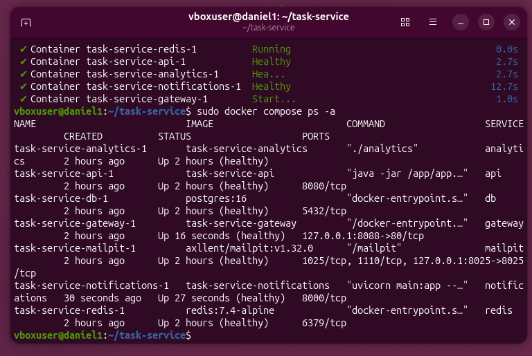
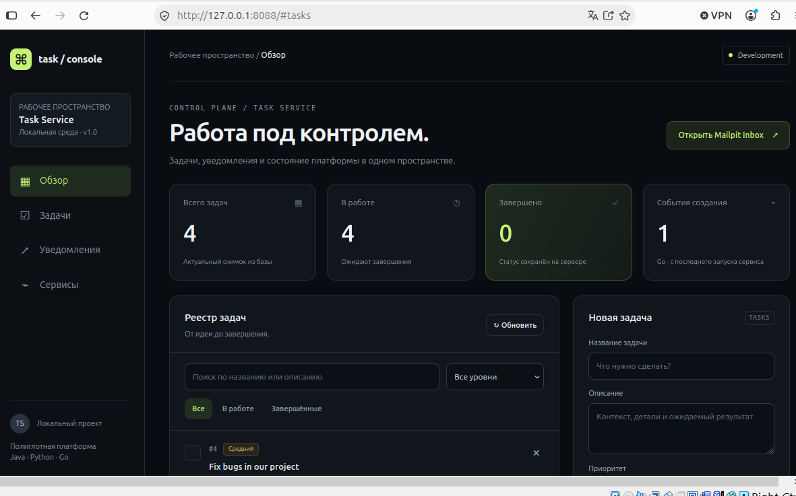
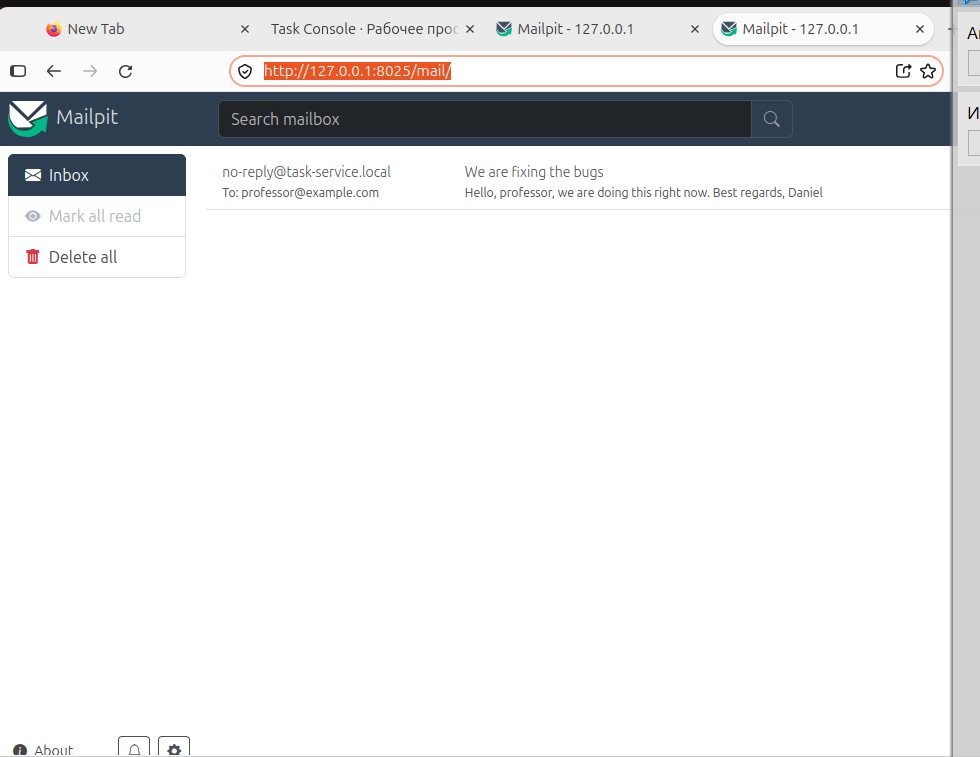

# Доказательства запуска и проверки

## Запуск в Ubuntu

Скриншоты предоставлены автором проекта 5 ноября 2026 года. На них показан
работающий Docker Compose с PostgreSQL, интерфейс задач и письмо в Mailpit.
Перенос Java-кода в api-service/ выполнен позднее; новую структуру отдельно
проверяет автоматический сценарий.

### Семь работающих контейнеров



Gateway опубликован на 127.0.0.1:8088, Mailpit — на 127.0.0.1:8025.
У контейнеров отображается healthy.

### Веб-интерфейс



### Письмо, принятое по SMTP



Это локальная доставка в Mailpit, а не отправка во внешний ящик.

## Воспроизводимая проверка новой структуры

Из корня проекта:

```bash
sudo bash scripts/check.sh --check-persistence
```

Скрипт сохраняет реальный вывод запуска и API в `docs/evidence/runtime/`.
Он проверяет CRUD задач, валидацию, Go-счётчик, SMTP и сохранность данных
после пересоздания контейнеров PostgreSQL и Mailpit с теми же томами.
Успешное выполнение заканчивается строкой `RESULT: PASS`.

Для нового прогона на Ubuntu сценарий запускает настоящий PostgreSQL 16
из Compose и сохраняет реальный вывод в runtime/. Этот каталог исключён
из Git; выбранные результаты можно приложить к сдаче после просмотра.

Локальные проверки подготовки и их ограничения описаны в
[validation.md](validation.md).
